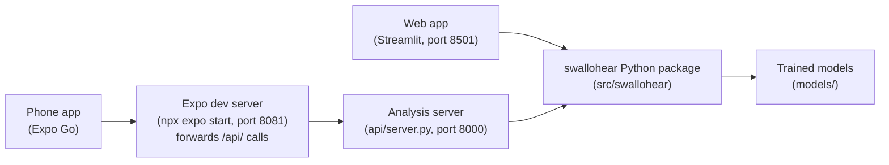

<div align="center">


# SWALLOHear: Reliability-Aware Swallowing Detection for Post-Stroke Dysphagia Screening

Philippine Junior Data Science Challenge (PJDSC) 2026<br>
*Trace the Pattern, Target the Cure: Advancing Public Health Through Data Science*

<p>
  
  
  
  
  <a href="https://doi.org/10.5281/zenodo.4539695"></a>
</p>

<p>
  <b>Paper</b>&nbsp;&nbsp;<a href="docs/SWALLOHear_Research_Paper.pdf" title="Research paper (PDF)">PDF</a>&nbsp;·&nbsp;<a href="docs/SWALLOHear_Research_Paper.md" title="Research paper (read on GitHub)">Read&nbsp;on&nbsp;GitHub</a>
  &emsp;|&emsp;
  <b>Web&nbsp;app</b>&nbsp;&nbsp;<a href="docs/APP_GUIDE.md" title="Web app guide">Guide</a>&nbsp;·&nbsp;<a href="docs/demo.webm" title="Web app demo video">Demo&nbsp;video</a>
  &emsp;|&emsp;
  <b>Mobile&nbsp;app</b>&nbsp;&nbsp;<a href="docs/MOBILE_GUIDE.md" title="Mobile app guide">Guide</a>&nbsp;·&nbsp;<a href="docs/mobile-demo/README.md" title="Mobile app walkthrough">Walkthrough</a>
</p>

</div>

> [!WARNING]
> **Research prototype, not a diagnostic device.** SWALLOHear detects swallowing-related sounds in neck-microphone audio
> and says how far to trust each result. It does **not** assess dysphagia, aspiration or pneumonia and must not be used to
> make care decisions. Do not upload identifiable patient audio to a shared server.


**Web app demo video:** [`docs/demo.webm`](docs/demo.webm) (55 seconds, no audio). Download it and open it in a
browser or video player.

> [!TIP]
> **Fastest way to try it:** run the [web app](#option-a-web-app-on-your-computer) and choose **Demo** in the sidebar.
> The demo clips are included in the repository, so there is no dataset to download.

## At a glance

- **It checks the recording first.** If the audio is too poor to judge, the result is withheld instead of guessed.
- **It shows how far to trust each detection.** Every detected swallow-related sound is labelled **Confident** or **Low-confidence**.
- **It explains itself.** Each reliability score comes with an exact breakdown, so you can see which measurements raised or lowered it.
- **It works on the web and on your phone.** The same Python models power a website (Streamlit) and an Android/iPhone app (Expo), so both give identical results.
- **Headline result:** reporting only Confident events raises precision from **0.41 to 0.69** and cuts false detections from
  **9.4 to 1.5 per minute**, at the cost of recall (**0.63 to 0.33**). See [What we found](#what-we-found).

## Contents

- [What is SWALLOHear?](#what-is-swallohear)
- [Features](#features)
- [Screenshots](#screenshots)
- [How it works](#how-it-works)
- [Quick start](#quick-start)
- [Using the app](#using-the-app)
- [What we found](#what-we-found)
- [Limitations and ethics](#limitations-and-ethics)
- [Reproduce the experiments](#reproduce-the-experiments)
- [Repository layout](#repository-layout)
- [Developer notes](#developer-notes)
- [Troubleshooting](#troubleshooting)
- [Data, licence and citation](#data-licence-and-citation)

---

## What is SWALLOHear?

About **4 in 10 people who have an acute stroke develop dysphagia** (difficulty swallowing), which is linked to about
four times higher odds of pneumonia and of death (Banda et al., 2022). The best tests (videofluoroscopy) need X-ray
equipment and specialists. **Cervical auscultation**, listening to swallowing sounds at the neck with a microphone, is
cheap and non-invasive, but automatic analysis of those sounds usually fails silently: it gives confident-looking answers
on noisy recordings and on people it has never heard before.

SWALLOHear is built around that reliability gap. For every recording it:

1. **checks the recording quality** first, and withholds the result ("Inconclusive") if the audio is too poor to judge;
2. **finds each swallowing-related sound** and gives its start time, end time and duration;
3. **scores how trustworthy each detection is** with a separately trained reliability model, and labels it
   **Confident** or **Low-confidence**, instead of presenting every guess as certain;
4. **explains** each score, measures **swallowing rhythm**, compares against **expert labels** where available, and
   exports everything.

## Features

Every feature below is available in **both the web app and the mobile app**.

### Get audio in

- **Demo clips** from held-out test participants, with expert labels
- **Upload your own audio** (WAV and FLAC on web, up to 120 s; plus M4A, MP3 and WebM on mobile)
- **Record** from the microphone
- **Synthetic test signals**

### Read the result

- **Verdict banner:** Events detected, No event detected, or Result withheld, with reason codes
- **Interactive timeline:** waveform, spectrogram and detector score; tap or click an event
- **Event card:** listen to the event, see its reliability gauge, top reasons and a zoomed view
- **Your own call** on each event (Swallow, Not swallow or Unsure)
- **"Why this score?":** the exact breakdown of each event's reliability score
- **Rhythm:** rate, intervals, regularity and longest pause

### Check how far to trust it

- **Signal quality:** every quality-gate check, the SNR estimate explained, and the spectrum
- **Robustness lab:** re-run a clip at 7 noise levels and watch the quality gate react
- **Stress test:** add white, pink or 60 Hz mains-hum noise, or simulated clipping
- **Expert comparison:** precision, recall, F1, timing error, and Expert-vs-System lanes
- **Live detector settings:** 5 thresholds you can change, with a reset to the validated values

### Compare, export and customise

- **Compare** two recordings (or one clip clean vs noisy) side by side
- **Batch analysis** of many recordings
- **Method and results page** with the experiment charts
- **Exports:** events CSV, full JSON, annotations, session log, and a printable HTML/PDF report
- **Light and dark mode** (the ☀ / ☾ switch in the header)

Every feature is explained step by step, with screenshots, in the [research paper](docs/SWALLOHear_Research_Paper.md#7-user-guide),
the [web app guide](docs/APP_GUIDE.md) and the [mobile app guide](docs/MOBILE_GUIDE.md).

## Screenshots

Click any image for the full-size version.

**Web app** (left to right: Analyze overview, Timeline, "Why this score?")

<p>
  <a href="docs/images/01_analyze_overview.png"></a>
  <a href="docs/images/02_timeline.png"></a>
  <a href="docs/images/05_why_this_score.png"></a>
</p>

**Phone app** (left to right: animated highlights, Analyze, Timeline, "Why this score?", dark mode)

<p>
  <a href="docs/mobile-demo/README.md"></a>
  <a href="docs/images/mobile/m01_analyze.png"></a>
  <a href="docs/images/mobile/m02_timeline.png"></a>
  <a href="docs/images/mobile/m05_why_this_score.png"></a>
  <a href="docs/images/mobile/m16_dark_mode.png"></a>
</p>

The phone stills come from the app's web build at phone size; on a real phone, navigation is the native bottom tab bar.
For every screen, see the [web app guide](docs/APP_GUIDE.md#tour-of-the-features), the
[mobile app guide](docs/MOBILE_GUIDE.md#tour), or the [mobile app walkthrough](docs/mobile-demo/README.md), which shows each
feature one by one in an iPhone-sized frame with a finger indicator for every tap.

## How it works


1. **Audio in.** Any sample rate is converted to 4 kHz mono, the rate of the research dataset.
2. **Quality gate.** The app estimates the signal-to-noise ratio (SNR) from the recording itself and checks for clipping,
   dropouts, too-low bandwidth and length (1–120 s). If any check fails, the result is **withheld** rather than guessed.
3. **Detector.** A Random Forest, trained with added noise, scores every 16 ms step of the audio for how swallow-like it
   sounds, using 81 acoustic features.
4. **Events.** A score above 0.70 starts an event, it continues while the score stays above 0.65, and events less than
   0.4 s apart are merged.
5. **Reliability.** A second, separately trained model looks at seven measurements of each event (how high the score
   peaked, how long it lasted, how loud it was, …) and gives a **reliability score**. Events at or above 0.50 are
   **Confident**; the rest are **Low-confidence**.

All thresholds were chosen on validation participants only. The 27 test participants were used once, for reporting.

**How the pieces connect.** The web app and the mobile app both use the same `swallohear` Python package and trained
models, so a phone and a browser give identical results. The web app calls the package directly. On the phone, the
analysis runs in Python on your computer: the app talks to the Expo dev server, which forwards every `/api/…` request to
a small analysis server (`api/server.py`).



<details>
<summary>Technical details of the pipeline</summary>

**Processing steps**

1. Resample to 4 kHz, band-pass 20–1800 Hz, then normalise robustly.
2. Compute quality indicators: SNR, clipping, dropouts, bandwidth and length.
3. Score every 64 ms frame (16 ms hop) with the Random Forest, and compute frame energies.
4. Apply the quality gate. If it fails, the result is withheld, but the candidate events are kept for inspection.
5. Assemble events: start at or above the *start* threshold, continue at or above the *continue* threshold, merge gaps
   shorter than the *merge gap*.
6. Run the reliability model on each event: **Confident** at or above the reliability threshold, otherwise **Low-confidence**.

Steps 1–3 are `Analyzer.score()` (slow; the web app caches it) and steps 4–6 are `Analyzer.assemble()` (fast), both in
`src/swallohear/final.py`. That split is why moving a settings slider updates the result instantly. `Analyzer.analyze()`
calls both and returns the same result as before the split.

**Quality gate.** SNR is estimated from the recording itself as the 95th minus the 10th percentile of frame energy. The
default cut-off (about 11.5 dB) is the 5th percentile of clean validation recordings, roughly the worst clean recording
seen in training.

**Reliability model.** A `StandardScaler` followed by a `LogisticRegression`, trained on held-out detections to predict
whether each detected event is correct from seven measurements. Its score, not the detector's own confidence, decides the
tier. Because the model is linear in the scaled measurements, its output is exactly:

```text
log-odds    = intercept + Σ coef_i × (value_i − mean_i) / scale_i
reliability = 1 / (1 + e^(−log-odds))
```

Each term `coef_i × (value_i − mean_i) / scale_i` is one bar in the **Why this score?** chart. The intercept is the
*average event* bar, and the bars add up exactly to the event's reliability score. This is the model's real arithmetic,
not an approximation.

</details>

---

## Quick start

### Choose your path

| I want to… | I need | Go to |
|---|---|---|
| Try it on my computer (easiest) | Python 3.13 | [Option A: Web app](#option-a-web-app-on-your-computer) |
| Use it on my phone | Python 3.13, Node.js, Expo Go | [Option B: Mobile app](#option-b-mobile-app-on-your-phone) |
| Try the mobile app without a phone | Python 3.13, Node.js | [Mobile app in a browser](#no-phone-use-the-mobile-app-in-your-browser) |
| Just look, without installing anything | A browser | [Web app demo video](docs/demo.webm) or [mobile app walkthrough](docs/mobile-demo/README.md) |
| Reproduce the paper's numbers | Python 3.13, the Zenodo data | [Reproduce the experiments](#reproduce-the-experiments) |

### What you need

- **Windows, macOS or Linux**, with **Python 3.13** ([python.org](https://www.python.org/downloads/), or `py install 3.13` on Windows).
- **Node.js 22 or 24 LTS**, only for the mobile app ([nodejs.org](https://nodejs.org)). Node 25 works but prints
  "Unsupported engine" warnings.
- **Expo Go** on your phone, only for the mobile app (App Store or Google Play).
- About 1 GB of free disk space.

### One-time setup

Open a terminal (on Windows, *Command Prompt*) and run the commands for your system.

**Windows**

```bat
git clone https://github.com/jedelacruz/swallohear.git
cd swallohear
py -3.13 -m venv .venv
.venv\Scripts\activate
pip install -r requirements.txt
python -m pytest -q
```

**macOS and Linux**

```bash
git clone https://github.com/jedelacruz/swallohear.git
cd swallohear
python3.13 -m venv .venv
source .venv/bin/activate
pip install -r requirements.txt
python -m pytest -q
```

After the `activate` step your prompt starts with `(.venv)`. The last command runs the tests: **8 tests should pass in
about 10 seconds**, which confirms everything is installed correctly. `requirements.txt` pins `numpy==2.2.6`,
`scipy==1.15.3`, `scikit-learn==1.6.1` and `pandas==2.2.3`, established releases that also load on locked-down Windows
PCs (see [Troubleshooting](#troubleshooting)).

> [!NOTE]
> Every time you open a new terminal, go to the `swallohear` folder and activate the environment again
> (`.venv\Scripts\activate` on Windows, `source .venv/bin/activate` on macOS and Linux).

### Option A: Web app on your computer

```bash
streamlit run app/streamlit_app.py
```

Your browser opens at **http://localhost:8501**. Choose **Demo** in the sidebar and pick a clip. Press **Ctrl+C** in the
terminal to stop. Other devices on your Wi-Fi can open the *Network URL* that the terminal prints. The app needs the
trained models in `models/` and the demo clips in `data/demo/`, both included in the repository.

> [!NOTE]
> After pulling new code, **stop the server (Ctrl+C) and start it again.** Streamlit reloads files in `app/` by itself,
> but not the `swallohear` package in `src/`.

### Option B: Mobile app on your phone

The phone app sends audio to a small analysis server on your computer, through the same Expo connection that loads the
app, so there is no server address to set up. The phone and the computer must be able to reach each other: the same
Wi-Fi, a hotspot from either device, or `npx expo start --tunnel`.

**Terminal 1: analysis server** (environment active, in the `swallohear` folder)

```bash
pip install imageio-ffmpeg
python api/server.py
```

`imageio-ffmpeg` decodes phone recordings (M4A/AAC, or WebM in a browser); skip the `pip install` line if it is already
installed. The first time, Windows asks whether Python may use the network. Allow it on **private networks**, or the
phone cannot reach the server.

**Terminal 2: the app**

```bash
cd mobile
npm install
npx expo start
```

Scan the QR code: on **Android** with the Expo Go app, on **iPhone** with the Camera app. If Windows asks whether
Node.js may use the network, allow it.

> [!IMPORTANT]
> **iPhone only:** Expo Go needs the same free Expo account on the phone and the computer. Create one at
> [expo.dev/signup](https://expo.dev/signup), sign in inside Expo Go, then run `npx expo login --no-browser` on the
> computer before `npx expo start`.

#### No phone? Use the mobile app in your browser

With the server and `npx expo start` running as above, press **w** in Terminal 2, or run `npx expo start --web`. The
mobile app opens in your browser at **http://localhost:8081**.

#### Running everything at once

You can run the web app, the phone app and the browser version **at the same time**. They use different ports:
8501 (web app), 8000 (analysis server) and 8081 (mobile app in the browser).

#### Using a different analysis server

The app finds the server automatically. To point it at a separately hosted server instead, open **Settings** (the gear
icon) → **Analysis server**. Choose **Automatic** to go back.

<details>
<summary>Build a standalone phone app (optional)</summary>

Expo Go is enough for development and demos. To make an installable app, use EAS Build (no Android Studio or Xcode needed):

```bash
npx eas-cli@latest build --platform android --profile preview
```

Release builds can already talk to an `http://` server on the local network (`usesCleartextTraffic` on Android and
`NSAllowsLocalNetworking` on iOS, both set in `mobile/app.json`). For use outside the local network, host
`api/server.py` behind HTTPS and set its address under **Settings → Analysis server**.

</details>

---

## Using the app

### The four pages

| Page | What it does |
|---|---|
| **Analyze** | Pick a source (Demo, Upload, Record or Synthetic), then read the verdict, five summary cards (confident events, low-confidence events, event rate, estimated SNR with its margin over the quality gate, processing time) and seven tabs: Timeline, Events, Rhythm, Robustness lab, Signal quality, Expert comparison and Session. |
| **Compare** | Pick a recording for **A** and **B** (demo clip or upload, each with optional noise), or use a preset: *Same clip: clean vs noisy* or *Two different clips*. You get a side-by-side table with a **B − A** column, both detector scores overlaid, and aligned timelines. |
| **Batch** | Choose demo clips and/or upload several files, optionally add noise to all of them, and analyse. You get totals (recordings, withheld, confident events, mean F1), a sortable table, an SNR-vs-events chart against the quality gate, and CSV/JSON downloads. |
| **Method & results** | The four-step pipeline, interactive charts drawn from `results/` (noise robustness, and ordinary vs reliability-aware output at each noise level), headline numbers and limits. |

On the phone, the four pages are the bottom tab bar, and the gear icon opens the detector settings.

### Reading the verdict

| Verdict | Meaning |
|---|---|
| **Events detected** | The recording passed the quality gate and events were found. |
| **No event detected** | Quality was fine, but nothing crossed the threshold. |
| **Result withheld** | Quality was too poor, so the result is withheld instead of guessed. The reason codes are shown as chips (for example, *Low SNR*). |

### Reading the timeline and events

- **Timeline panels.** Three stacked, zoomable panels share one time axis: the **waveform**, the **spectrogram**
  (0–2 kHz, where swallow sounds show up as bright vertical bursts) and the **detector score** for every 16 ms step, with
  the start and continue thresholds as dashed lines.
- **Colours.** Shaded bands are detected events: **teal = Confident**, **amber = Low-confidence**. Dotted green outlines
  are the expert labels, which you can switch on or off.
- **Zooming.** On the web, drag to zoom and double-click to reset. On the phone, zoom 1–8× and swipe sideways.
- **Event card.** Click or tap a numbered marker, or use **Prev / Next**. You can listen to a clip of just that event
  (with 0.25 s either side), see the reliability gauge against the threshold, read the top reasons (↑ raised the score,
  ↓ lowered it), and see a zoomed view. Then make **your call**: *Swallow*, *Not swallow* or *Unsure*. Your calls appear in
  the event table, the exports and the report.
- **"Why this score?"** The chart starts from an *average event*. Each of the seven measurements adds (teal) or
  subtracts (amber) evidence, and the last bar is *this event's* score, compared with the threshold. A table beside it
  compares this event's values with a typical event's.
- **Raw detector confidence vs reliability.** An expander plots both scores for every event. It shows why the app uses the
  learned reliability score: in testing, the raw detector score was a poor guide to correctness (AUROC 0.53 vs 0.79).

### Rhythm

The Rhythm tab describes how events are spread over time. It needs at least two events, and you can limit it to
**Confident events only**.

| Measure | How it is calculated |
|---|---|
| Events and rate | Count and events per minute |
| Mean interval | Onset to onset, between consecutive events |
| Regularity | Coefficient of variation (standard deviation ÷ mean) of the intervals: under 0.25 is *steady*, 0.25–0.5 *moderate*, above 0.5 *irregular* |
| Longest quiet gap | Includes the stretch before the first event and after the last |

Rhythm is descriptive only: short clips give few intervals, and missed or false detections distort the numbers.

### Signal quality, expert comparison, stress test and robustness

- **Signal quality.** Each quality-gate check is shown with a pass/fail icon, its value and its limit (SNR, clipping,
  dropouts, bandwidth, duration). A histogram of frame energies shows the noise floor (10th percentile) and peaks (95th
  percentile); the SNR estimate is the gap between them. In the average spectrum, spikes at 60, 120 and 180 Hz point to
  mains hum, and a raised flat line points to broadband hiss.
- **Expert comparison.** For recordings with expert labels (demo clips and synthetic signals), you see matched events,
  false detections, misses, precision, recall and F1, plus **Expert vs System** lanes. A detection counts as matched when
  it overlaps a labelled swallow by at least half. **One clip proves nothing.**
- **Stress test.** Add white, pink or 60 Hz mains-hum noise at an SNR from −5 to 30 dB, or simulate clipping (the input
  is boosted 4× and hard-clipped, like a microphone gain set too high). For example, a clean clip with white noise at 10 dB
  drops the estimated SNR below the gate, so the verdict becomes **Result withheld** with the reason *Low SNR*.
- **Robustness lab.** Press **Run sweep** to re-analyse the recording at seven noise levels (clean, then 30 down to 0 dB)
  with the noise type you choose. The chart stacks Confident, Low-confidence and Withheld events and overlays the
  estimated SNR against the quality-gate line, so you can see where the system stops reporting and withholds instead. The
  table adds F1 against the expert labels at each level.

### Detector settings

All five settings are live sliders. A badge shows when you are off the validated values, and **Reset to validated**
restores them. The reported results always use the validated values.

| Setting | What it does | Validated value |
|---|---|---|
| Reliability threshold | Events at or above it are *Confident*. Higher means fewer events, more of them correct. | 0.50 |
| Start threshold | Frame score that starts an event. | 0.70 |
| Continue threshold | Frame score that keeps an event going (capped at the start threshold). | 0.65 |
| Merge gap | Events closer than this are merged. | 0.4 s |
| Quality gate: minimum SNR | Below this the result is withheld. | about 11.5 dB |

### Exports and your data

| Where | What you get |
|---|---|
| **Report** (Analyze header) | A self-contained HTML report: disclaimer, verdict, summary, timeline, events-over-time chart, event table with reasons and your calls, rhythm, expert agreement, quality gate, settings and limits. It works offline (about 5 MB). Open it and press **Ctrl+P → Save as PDF** for a PDF. On the phone it opens in the phone's browser, where you can share it or print to PDF. |
| **Events (CSV)** | One row per event: times, duration, reliability, raw confidence, tier, your call. |
| **Full result (JSON)** | Status, reason codes, settings, stress test, events, withheld candidates, quality and annotations. |
| **My annotations** | Only the events you gave a call. |
| **Session log / All annotations** | Every analysis you ran this session, and all your calls. |
| **Batch CSV / JSON** | One row per recording. |

On the phone, downloads open the **share sheet** (save to Files, email, chat…). **Your calls and the session log live
only in the open browser tab or app session, so download them if you want to keep them.**

---

## What we found

Setup: a single participant-disjoint split; 27 held-out test participants (171 recordings, 288 labelled swallows).
Events count as matched when they overlap a labelled swallow by at least half (IoU ≥ 0.5). 95% confidence intervals come
from a participant-level bootstrap. Full tables and discussion are in the
[research paper](docs/SWALLOHear_Research_Paper.md#5-results).

| Question | Result |
|---|---|
| How well are swallows detected on clean audio? | Energy baseline F1 **0.28** (95% CI 0.23–0.34); Random Forest F1 **0.50** (0.40–0.59). |
| Does it survive noise? | A clean-trained model collapses (F1 0.14 at 20 dB, 0.00 at 10 dB). Training with noise keeps F1 **0.45 / 0.39 / 0.31** at 20 / 10 / 5 dB. |
| Can the detector's own confidence be trusted? | **No.** It separates correct from wrong detections barely better than chance (AUROC **0.53**). The learned reliability score does much better (AUROC **0.79**). |
| Does reliability-aware output help? | Reporting only Confident events raises precision from **0.41 to 0.69** and cuts false detections from **9.4 to 1.5 per minute**, at the cost of recall (**0.63 → 0.33**). |
| Does the quality gate catch bad recordings? | It withholds **2%** of clean recordings, **30%** at 20 dB, **82%** at 10 dB and **94%** at 5 dB, instead of reporting results it cannot trust. |
| Is a neck accelerometer better than the microphone? | Not in this pipeline (F1 0.47 vs 0.49). |
| Is it fast enough? | A 30-second clip is analysed in a median **0.13 s** on a laptop CPU (target: ≤ 5 s). |

## Limitations and ethics

- **Modest accuracy.** Event F1 is about 0.5, far from clinical standard. The reliability-aware output buys precision
  with a large loss of recall: a trade-off, not a free improvement.
- **One dataset, one split.** Results come from one public US dataset and 27 test participants. Nothing has been
  validated on Philippine patients, phones or low-cost stethoscopes.
- **Synthetic noise.** Noise tests use added white noise, not real rooms.
- **Possibly incomplete labels.** Some "false detections" may be real swallows that were never labelled.
- **No stroke-specific claims.** The dataset's `ns`/`s` file groups were never verified, so they are not treated as stroke labels.
- **No CNN.** The proposed compact CNN (M2) was not built; the Random Forest is the final detector.
- **Privacy.** Audio is processed in memory and not stored. Only public, de-identified research data are used.

---

## Reproduce the experiments

The research data are not stored in this repository. Download `signals.zip` and `labels.zip` from
[Zenodo (DOI 10.5281/zenodo.4539695)](https://doi.org/10.5281/zenodo.4539695) into `data/raw/`, then run the steps below
in order. Random seeds are fixed, and steps 3–6 take about 30 minutes on a laptop CPU.

<details>
<summary>Show the 8 steps</summary>

| Step | Command | What it does |
|---|---|---|
| 1 | `python scripts/prepare_data.py --dir data/raw` | Verifies MD5 checksums and unpacks to `data/interim/` |
| 2 | `python scripts/build_index.py` | Sanity checks and the participant-disjoint 70/15/15 split |
| 3 | `python scripts/evaluate_baselines.py` | Energy baseline vs Random Forest (`results/baselines.json`) |
| 4 | `python scripts/run_experiments.py` | Calibration, confidence, noise, sensor ablation; trains `models/rf_mic.joblib` |
| 5 | `python scripts/run_reliability_v2.py` | Noise-augmented RF, learned reliability model, quality gate (`models/*.joblib`, `configs/final.json`) |
| 6 | `python scripts/bootstrap_ci.py` | Participant-level 95% confidence intervals; checks itself against step 5 |
| 7 | `python scripts/make_demo_clips.py` | Demo clips, from test participants only |
| 8 | `python scripts/make_paper.py figures` | Redraws the paper's figures from `results/` |

</details>

## Repository layout

<details>
<summary>Show the folder guide</summary>

| Path | What it is |
|---|---|
| `src/swallohear/` | The core Python package: audio loading, preprocessing, features, detectors, quality gate, reliability model (`final.py`) |
| `app/streamlit_app.py`, `app/views/` | The web app (Analyze, Compare, Batch, Method & results pages) |
| `api/server.py` | HTTP API used by the mobile app |
| `mobile/` | The Expo / React Native mobile app |
| `mobile/src/app/` | Expo Router routes (one file per tab) |
| `mobile/src/screens/` | The four screens; `analyze/` holds the source panel and the seven tabs |
| `mobile/src/components/` | UI kit (`ui.tsx`), SVG charts (`charts.tsx`), audio player, header and settings sheet, tab bars |
| `mobile/src/lib/` | API client, app state (theme, settings, calls, session), theme colours, exports, rhythm maths |
| `models/` | Trained models (noise-augmented Random Forest, reliability model) |
| `configs/final.json` | Thresholds selected on validation participants |
| `results/` | Experiment outputs (JSON) that every reported number comes from |
| `data/demo/` | Seven demo clips from held-out test participants (CC BY 4.0) |
| `scripts/` | Data preparation, experiments, demo clips, documentation figures and screenshots |
| `tests/` | Unit tests (`test_core.py`) and the API smoke test (`test_api.py`) |
| `docs/` | Research paper, web and mobile guides, screenshots, demo GIF and video |

</details>

## Developer notes

<details>
<summary>API, checks and regenerating the docs</summary>

**Mobile stack.** The mobile app is an [Expo](https://expo.dev) (React Native) app that runs on Android and iOS from one
codebase, and in a browser for quick checks. Charts are drawn with `react-native-svg`; the spectrogram is rendered as an
image by the server. The server (`api/server.py`) is built on Starlette and uvicorn, which Streamlit already installs, so
there are no new compiled packages for Windows Smart App Control to block.

**API endpoints.** `/api/meta`, `/api/load`, `/api/analyze`, `/api/sweep`, `/api/batch`, plus audio and report endpoints.
The Expo dev server (`mobile/metro.config.js`) forwards every `/api/…` request to `api/server.py` on the same computer.
The server keeps the last 40 recordings in memory.

**Checks.** Run the first three inside `mobile/`:

```bash
npm run typecheck
npm run lint
npx expo-doctor
python tests/test_api.py
```

`tests/test_api.py` starts the API and calls every endpoint, including an M4A upload.

**Regenerate the screenshots and video.** `scripts/capture_docs.py` starts the web app, drives it in Microsoft Edge with
Playwright, and rewrites `docs/images/*.png`, `docs/demo.gif` and `docs/demo.webm`. Playwright is a development-only tool,
so it is not in `requirements.txt`:

```bash
pip install playwright
python -m playwright install ffmpeg
python scripts/capture_docs.py
```

Use `--browser chrome` to drive Google Chrome instead of Edge. `scripts/capture_mobile.py` regenerates the phone
screenshots (the API and `npx expo start --web --port 8081` must be running), and `mobile/scripts/make_icons.py` draws
the app icon and splash image.

</details>

## Troubleshooting

<details>
<summary>Show common problems and fixes</summary>

| Problem | Fix |
|---|---|
| `DLL load failed … An Application Control policy has blocked this file` | Windows 11 Smart App Control blocks unsigned compiled files that Microsoft has not seen enough of yet, which includes the very newest `pandas`, `scikit-learn` and Python releases. Use Python 3.13 and `pip install -r requirements.txt` (it pins versions that load). |
| `'LogisticRegression' object has no attribute 'multi_class'` | The models were saved with a different scikit-learn version than the one installed. Reinstall the pinned versions with `pip install -r requirements.txt` (the models in `models/` were retrained with scikit-learn 1.6.1). |
| `'streamlit'` or `'python'` is not recognized | Go to the `swallohear` folder and activate the environment first (`.venv\Scripts\activate` on Windows). |
| `AttributeError: 'Analyzer' object has no attribute 'score'` | The server was started before you updated the code. Stop it with Ctrl+C and start it again. Streamlit reloads `app/` by itself but not the package in `src/`. |
| Blank page after restarting a server | The browser tab was still connected to the old server. Reload the page. |
| Phone app: "Can't reach the analysis server" | Make sure `python api/server.py` is running on the same computer as `npx expo start`, then reload the app. In Settings (gear icon) → Analysis server, choose **Automatic**. If Windows asked about network access, allow Python on **private networks**. |
| Expo Go: "The request timed out" | The phone can't reach the computer. After changing Wi-Fi, restart `npx expo start` and scan the **new** QR code (never reopen an old project from *Recently opened*). Many routers and Android hotspots block devices from talking to each other: use the computer's own **Mobile Hotspot** (Windows Settings → Network & internet), or your iPhone's **Personal Hotspot** with the computer joined to it. |
| iPhone: "You need to be signed in to Expo Go and Expo CLI" | Sign in to the same Expo account in Expo Go and with `npx expo login --no-browser` on the computer. |
| A recording uploads but fails to decode | Run `pip install imageio-ffmpeg` in the environment (needed for M4A, AAC and WebM). |
| "Recording expired; load it again" | The server keeps the last 40 recordings in memory, and restarting it clears them. Pick the clip again. |
| The microphone does nothing | Allow microphone access for Expo Go (or SWALLOHear) in the phone's settings. |

</details>

---

## Data, licence and citation

**Data:** Khalifa, Y., Donohue, C., Coyle, J., & Sejdić, E. (2021). *Swallowing High Resolution Cervical Auscultation
Signals* [Data set]. Zenodo. https://doi.org/10.5281/zenodo.4539695 (CC BY 4.0). The demo clips in `data/demo/` are
excerpts of this dataset under the same licence.

**Code:** see [LICENSE](LICENSE).

**Cite this work:** *SWALLOHear: Reliability-Aware Swallowing Detection for Post-Stroke Dysphagia Screening* (2026). Philippine Junior Data Science Challenge (PJDSC) 2026.
https://github.com/jedelacruz/swallohear

<details>
<summary>BibTeX</summary>

```bibtex
@misc{swallohear2026,
  title  = {SWALLOHear: Reliability-Aware Swallowing Detection for Post-Stroke Dysphagia Screening},
  year   = {2026},
  note   = {Philippine Junior Data Science Challenge (PJDSC) 2026},
  url    = {https://github.com/jedelacruz/swallohear}
}
```

</details>
