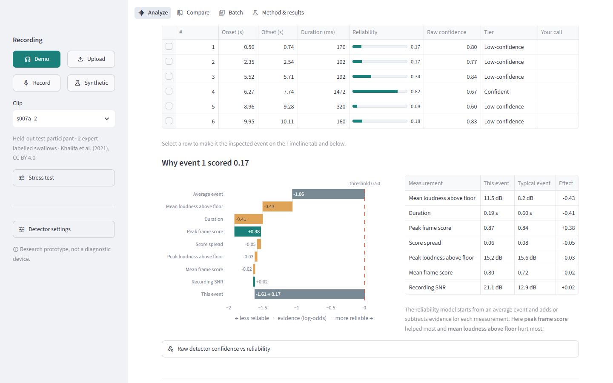
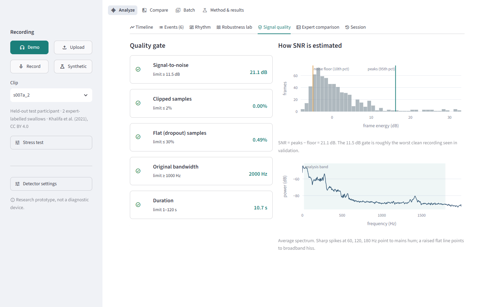
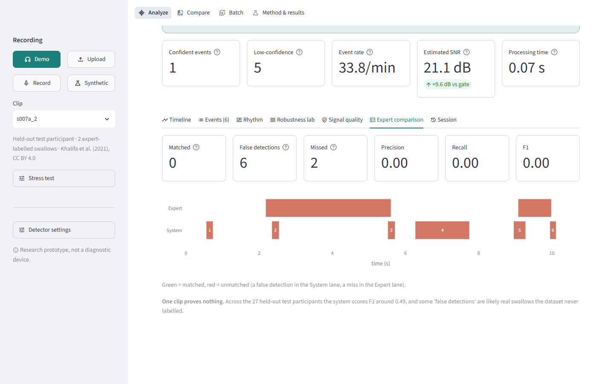
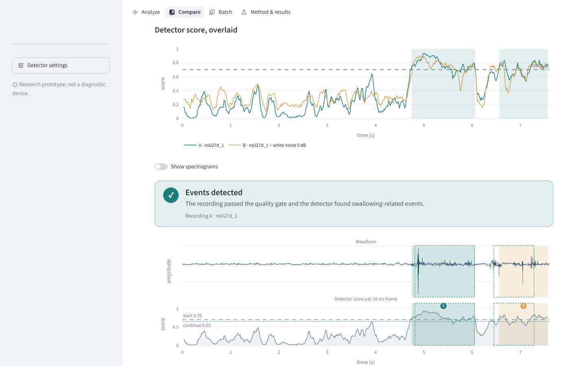
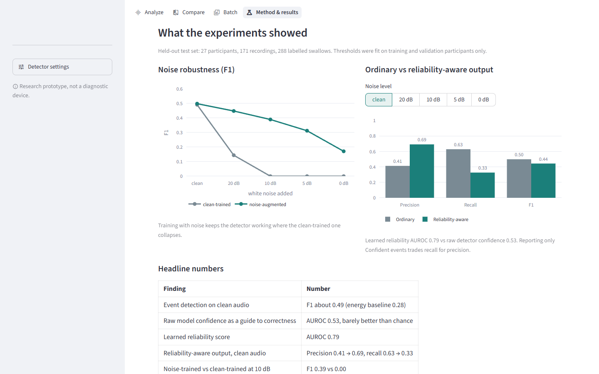
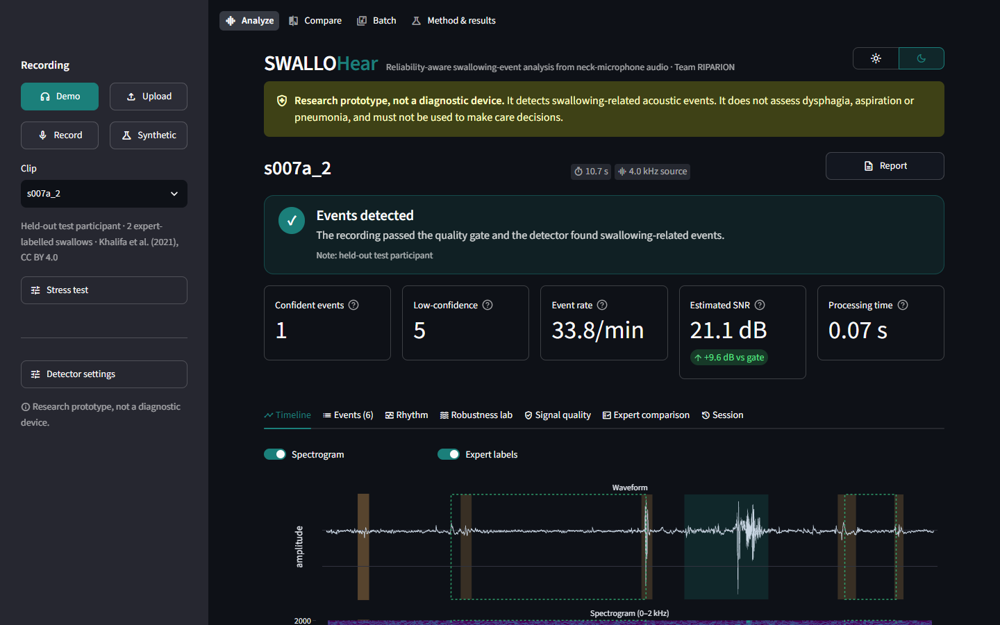

# SWALLOHear web app guide

> **Research prototype, not a diagnostic device.** The app detects swallowing-related acoustic events in neck-microphone
> audio and says how far to trust each one. It does not assess dysphagia, aspiration or pneumonia and must not be used to
> make care decisions.


**Full video walkthrough:** [`docs/demo.webm`](demo.webm) (55 seconds, no audio). Download it and open it in a browser or video player.

---

## Contents

1. [What changed](#what-changed)
2. [Run the app](#run-the-app)
3. [Tour of the features](#tour-of-the-features)
4. [How it works](#how-it-works)
5. [Exports](#exports)
6. [Troubleshooting](#troubleshooting)
7. [Regenerating these screenshots and the video](#regenerating-these-screenshots-and-the-video)

---

## What changed

### 1. The app runs again on locked-down Windows PCs

The app crashed on start with `ImportError: DLL load failed … An Application Control policy has blocked this file`.
Windows 11 **Smart App Control** blocks unsigned compiled files that Microsoft hasn't seen enough of yet. The very newest
`pandas` (3.1) and `scikit-learn` (1.9) wheels, and anything built for the then-brand-new Python 3.15, fell into that group.

| Change | Why |
|---|---|
| Project venv rebuilt on **Python 3.13** | Wheels for 3.13 have been around long enough to be trusted. |
| `requirements.txt` pins `numpy==2.2.6`, `scipy==1.15.3`, `scikit-learn==1.6.1`, `pandas==2.2.3` | Established releases that load under Smart App Control. |
| Models in `models/` and `results/*.json` **retrained** with scikit-learn 1.6.1 | The old pickles were saved by scikit-learn 1.9.1 and failed to load (`'LogisticRegression' object has no attribute 'multi_class'`). Retrained numbers match the reported ones (noise-augmented RF F1 0.50 clean, 0.45 / 0.39 / 0.31 at 20 / 10 / 5 dB). |

### 2. The web app was rebuilt

| Before | Now |
|---|---|
| One page with five tabs | Four pages: **Analyze**, **Compare**, **Batch**, **Method & results** |
| Demo, upload or synthetic input | Adds **record from your microphone** |
| Static waveform + score plot | Zoomable **waveform + spectrogram + score** timeline; **click an event** to inspect it |
| One threshold slider | **All five detector settings live**, with "reset to validated" |
| White noise only | **White, pink and 60 Hz mains-hum** noise at any level, plus **simulated clipping** |
| Event table | Sortable table, **"Why this score?"** breakdown, and your own call on each event |
| – | **Rhythm** tab, **Robustness lab** sweep, richer **Signal quality** tab, **Expert comparison** lanes |
| – | **Compare** two recordings, **Batch** many at once |
| CSV/JSON download | Adds a **printable HTML report**, annotations CSV and a session log |
| Light only | **Light/dark switch** in the header |

Under the hood, `Analyzer.analyze()` in `src/swallohear/final.py` is now split into `score()` (slow: preprocessing,
quality and the Random Forest, cached by the app) and `assemble()` (fast: quality gate, events, reliability). So moving a
slider updates instantly. `analyze()` returns exactly what it did before.

---

## Run the app

Windows (Mac/Linux: use `source .venv/bin/activate` and `python3`):

```bash
py install 3.13
py -3.13 -m venv .venv
.venv\Scripts\activate
pip install -r requirements.txt
streamlit run app/streamlit_app.py
```

The app opens at <http://localhost:8501>. It needs the trained models in `models/` and the demo clips in `data/demo/`,
both included in the repository.

> After pulling new code, **stop the server (Ctrl+C) and start it again.** Streamlit reloads files in `app/` by itself,
> but not the `swallohear` package in `src/`.

---

## Tour of the features

### Analyze page: overview


**How to use it**

1. Pick a **source** in the sidebar: **Demo** (held-out test participants, with expert labels), **Upload** (WAV or FLAC,
   up to 120 s), **Record** (your microphone) or **Synthetic** (generated test bursts).
2. Read the **verdict banner**:
   - **Events detected:** the recording passed the quality gate and events were found.
   - **No event detected:** quality was fine but nothing crossed the threshold.
   - **Result withheld:** quality was too poor, so the result is withheld instead of guessed. The reason codes are shown as chips.
3. Check the **five cards**: confident events, low-confidence events, event rate, estimated SNR (with its margin over the
   quality gate) and processing time.
4. Use **Report** (next to the recording name) to download a printable report. See [Exports](#exports).
5. Use the **☀ / ☾** switch in the top-right to change between light and dark mode.

### Timeline


Three stacked, zoomable panels that share one time axis:

- **Waveform:** the raw audio.
- **Spectrogram:** frequency content from 0 to 2 kHz. Swallow sounds show up as bright vertical bursts.
- **Detector score:** the Random Forest's score for every 16 ms step, with the **start** and **continue** thresholds as
  dashed lines.

Shaded bands are detected events: **teal = Confident**, **amber = Low-confidence**. Dotted green outlines are the expert
labels; turn them on or off with **Expert labels**. Drag to zoom, double-click to reset, and play the whole recording with
the audio player below.

### Event card


**Click a numbered marker** on the timeline, or use **Prev / Next**, to inspect one event:

- **Listen:** a clip of just that event, with 0.25 s either side.
- **Reliability gauge:** the event's reliability score against the threshold marker.
- **Reasons:** ↑ the measurements that raised the score most, ↓ those that lowered it most.
- **Zoomed view:** the waveform and detector score around the event.
- **Your call:** mark it *Swallow*, *Not swallow* or *Unsure*. Calls are kept while you move between events and appear
  in the event table, the exports and the report.

### Events tab and "Why this score?"



A sortable table of every event. **Select a row** to make it the inspected event everywhere in the app.


**Why this score?** breaks the selected event's reliability score into the push from each of the seven measurements the
reliability model uses. The chart starts from an *average event*. Each bar adds (teal) or subtracts (amber) evidence, and
the last bar is *this event's* score, compared against the threshold (red dashed line). The table beside it compares this
event's values with a typical event's. This is the model's real arithmetic, not an approximation; see
[How it works](#how-the-explanation-is-computed).

The **Raw detector confidence vs reliability** expander plots both scores for every event. It shows why the app uses the
learned reliability score: in testing, the raw detector score was a poor guide to correctness (AUROC 0.53 vs 0.79).

### Rhythm tab


How the events are spread over time:

- **Events** and **rate** per minute.
- **Mean interval:** onset to onset.
- **Regularity:** coefficient of variation of the intervals. Under 0.25 is *steady*, 0.25–0.5 *moderate*, above 0.5 *irregular*.
- **Longest quiet gap.**
- **Events over time:** cumulative count. A steady slope means a steady rhythm.
- **Time between consecutive events:** bars of similar height mean a regular rhythm.

Use **Confident events only** to ignore low-confidence detections. The tab needs at least two events. Rhythm is
descriptive only: short clips give few intervals, and missed or false detections distort the numbers.

### Robustness lab


Press **Run sweep** to re-analyse the original recording at seven noise levels (clean, then 30 down to 0 dB) with the
noise type you choose. The chart stacks Confident, Low-confidence and Withheld events and overlays the estimated SNR
against the quality-gate line. It shows the point where the system stops reporting and withholds instead. The table adds
F1 against the expert labels at each level.

### Signal quality



- **Quality gate:** each check with a pass/fail icon, its value and its limit (SNR, clipping, dropouts, bandwidth, duration).
- **How SNR is estimated:** a histogram of frame energies with the noise floor (10th percentile) and peaks (95th
  percentile). The SNR estimate is the gap between them.
- **Average spectrum:** spikes at 60, 120, 180 Hz point to mains hum; a raised flat line points to broadband hiss.

### Expert comparison



For recordings with expert labels (demo clips and synthetic signals): matched events, false detections, misses,
precision, recall and F1. **Expert vs System** lanes show green for matched and red for unmatched events. A detection
counts as matched when it overlaps a labelled swallow by at least half. One clip proves nothing.

### Stress test (sidebar)


Open **Stress test** in the sidebar:

- **Add noise:** choose white, pink or 60 Hz mains hum and an SNR from −5 to 30 dB.
- **Simulate clipping:** boost the input 4× and hard-clip it, like a microphone gain set too high.

The screenshot shows a clean clip with white noise at 10 dB: the estimated SNR drops below the gate, so the verdict
becomes **Result withheld** with the reason *Low SNR*.

### Detector settings (sidebar)

Live sliders for every setting the pipeline uses:

| Setting | What it does |
|---|---|
| Reliability threshold | Events at or above it are *Confident*. Higher means fewer events, more of them correct. |
| Start threshold | Frame score that starts an event. |
| Continue threshold | Frame score that keeps an event going (capped at the start threshold). |
| Merge gap | Events closer than this are merged. |
| Quality gate: minimum SNR | Below this the result is withheld. |

A badge shows when you are off the validated values; **Reset to validated** restores them. The reported results always
use the validated values.

### Compare page


Pick a recording for **A** and **B**, each a demo clip or an upload, each with optional noise. Or use a preset:
**Same clip: clean vs noisy** or **Two different clips**. You get:

- **Side by side:** status, event counts, SNR, mean reliability, rate, mean interval and F1 for both, with a **B − A** column.
- **Detector score, overlaid:** both score curves on one chart.



- **Aligned timelines:** both recordings on the same time axis, with verdicts. Turn on **Show spectrograms** if you need them.

### Batch page


Choose demo clips and/or upload several files, optionally add noise to all of them, and press **Analyse**. You get totals
(recordings, withheld, confident events, mean F1), a sortable table with mean reliability and F1 bars, an SNR-vs-events
chart against the quality gate, and CSV/JSON downloads. It uses the detector settings from the sidebar.

### Method & results page



The four-step pipeline, and interactive charts drawn from `results/`: noise robustness (clean-trained vs noise-trained)
and ordinary vs reliability-aware output at each noise level. Then headline numbers and limits.

### Dark mode



The **☀ / ☾** switch in the header changes the whole app, charts included. The choice stays as you move between pages.

---

## How it works

```
audio ─► resample to 4 kHz ─► band-pass 20–1800 Hz ─► robust normalise
     ─► quality indicators (SNR, clipping, dropouts, bandwidth, length)          ┐
     ─► Random Forest score for every 64 ms frame (16 ms hop)                     ├─ score()  (cached)
     ─► frame energies                                                            ┘
     ─► quality gate ── fail ──► "Result withheld" (candidates kept for inspection) ┐
     ─► events: start ≥ hi, continue ≥ lo, merge gaps < merge                      ├─ assemble()  (instant)
     ─► reliability model per event ─► Confident (≥ τ) / Low-confidence            ┘
```

- **Quality gate.** SNR is estimated from the recording itself as the 95th minus the 10th percentile of frame energy. The
  default cut-off (about 11.5 dB) is the 5th percentile of clean validation recordings, roughly the worst clean
  recording seen in training.
- **Detector.** A Random Forest trained with added noise scores each frame on spectral features.
- **Event assembly.** Two thresholds, so an event needs a confident start but survives brief dips. Nearby events are merged.
- **Reliability.** A separate logistic-regression model, trained on held-out detections, predicts whether each detected
  event is correct from seven measurements. Its score, not the detector's own confidence, decides the tier.

### How the explanation is computed

The reliability model is a `StandardScaler` followed by `LogisticRegression`, so its output is exactly

```
log-odds = intercept + Σ coef_i × (value_i − mean_i) / scale_i
reliability = 1 / (1 + e^(−log-odds))
```

Each term `coef_i × (value_i − mean_i) / scale_i` is one bar in the **Why this score?** chart. The intercept is the
*average event* bar: the score an event with every measurement at its training average would get. The bars add up
exactly to the event's reliability score.

### Rhythm numbers

Intervals are onset-to-onset times between consecutive events. Regularity is the coefficient of variation
(standard deviation ÷ mean) of those intervals. The longest quiet gap includes the stretch before the first event and
after the last.

### Light/dark switch

Streamlit has no official API for switching the theme from inside an app. The app stores your choice, sets the theme
on the server and reruns once, so the browser picks up the new theme. When run locally this is seamless. On a shared
server, two viewers who choose different themes each trigger one extra rerun when switching.

---

## Exports

| Where | Button | Contents |
|---|---|---|
| Analyze header | **Report** | Self-contained HTML report: disclaimer, verdict, summary, timeline, events-over-time chart, event table with reasons and your calls, rhythm, expert agreement, quality gate, settings and limits. Works offline (charts embedded, about 5 MB). Open it and press **Ctrl+P → Save as PDF** for a PDF. |
| Events tab | **Events (CSV)** | One row per event: times, duration, reliability, raw confidence, tier, your call. |
| Events tab | **Full result (JSON)** | Status, reason codes, settings, stress test, events, withheld candidates, quality and annotations. |
| Events tab | **My annotations** | Only the events you gave a call. |
| Session tab | **Session log / All annotations** | Every analysis you ran this session, and all your calls. |
| Batch page | **CSV / JSON** | One row per recording. |

Your calls and the session log live only in the open browser tab. Download them if you want to keep them.

---

## Troubleshooting

| Symptom | Fix |
|---|---|
| `ImportError: DLL load failed … Application Control policy has blocked this file` | Smart App Control is blocking a very new package. Use Python 3.13 and `pip install -r requirements.txt` (pinned versions). |
| `AttributeError: 'Analyzer' object has no attribute 'score'` | The server started before you updated the code. Stop it (Ctrl+C) and start it again. |
| Blank page after restarting the server | The browser tab was still connected to the old server. Reload the page. |
| `'streamlit' is not recognized` | Activate the venv first (`.venv\Scripts\activate`) from the repo folder. |

---

## Regenerating these screenshots and the video

`scripts/capture_docs.py` starts the app, drives it in Microsoft Edge with Playwright, and rewrites `docs/images/*.png`,
`docs/demo.gif` and `docs/demo.webm`. Playwright is a development-only tool, so it is not in `requirements.txt`:

```bash
pip install playwright
python -m playwright install ffmpeg
python scripts/capture_docs.py
```

Use `--browser chrome` to drive Google Chrome instead of Edge.
