# SWALLOHear mobile app guide

> **Research prototype, not a diagnostic device.** Same limits as the web app: it detects swallowing-related acoustic
> events and says how far to trust each one. It does not assess dysphagia, aspiration or pneumonia.

The mobile app is an [Expo](https://expo.dev) (React Native) app in [`mobile/`](../mobile). It runs on Android and iOS
from the same code, and in a browser for quick checks. It has every feature of the [web app](APP_GUIDE.md), with the
same colours and layout ideas.

**▶ Watch it:** the [mobile walkthrough](mobile-demo/README.md) shows every feature one by one: a full video, a clip
per feature and snapshots.

<p>
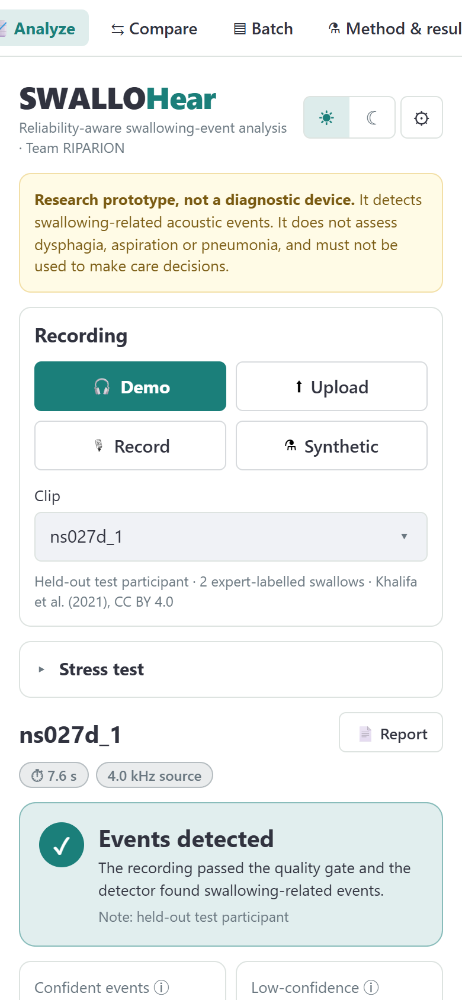
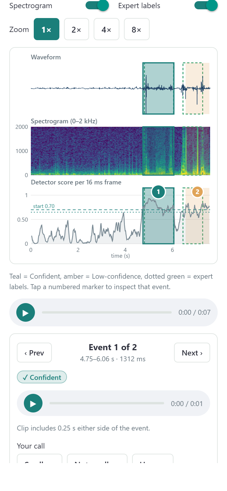
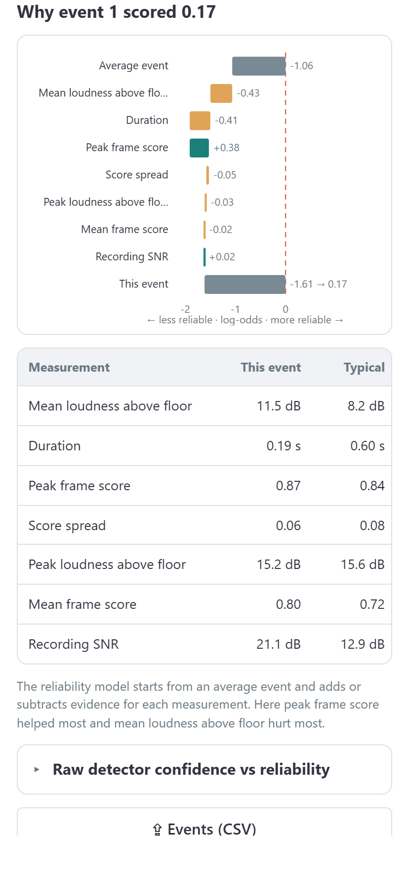
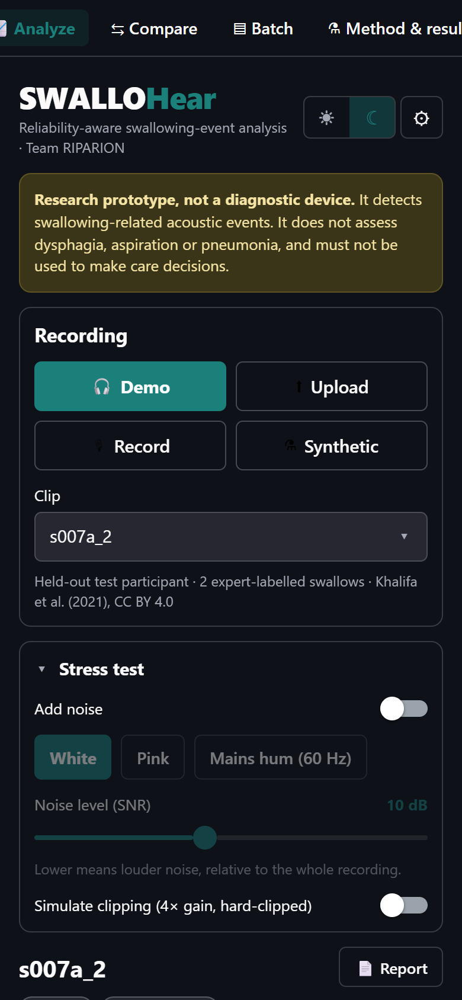
</p>

---

## How it works

```
 phone (Expo app)                          your computer
┌──────────────────────────┐  app + /api/…  ┌──────────────────────┐  /api/…  ┌────────────────────────────────┐
│ record / pick / demo     │ ─────────────► │ npx expo start       │ ───────► │ api/server.py (port 8000)      │
│ charts, tabs, your calls │ ◄───────────── │ (port 8081)          │ ◄─────── │ same models & helpers as the   │
│ share CSV / JSON / report│                │ forwards /api/ calls │          │ web app (app/views, src/)      │
└──────────────────────────┘                └──────────────────────┘          └────────────────────────────────┘
```

- The **analysis runs in Python on a server** (`api/server.py`), using exactly the same models and code as the web app,
  so the phone and the web app give identical results.
- The server is built on Starlette and uvicorn, which Streamlit already installs, so there are no new compiled packages
  for Smart App Control to block. Phone recordings (M4A/AAC, or WebM on web) are decoded with `imageio-ffmpeg`.
- **No server address to set up.** The Expo dev server (`mobile/metro.config.js`) forwards every `/api/…` request to
  `api/server.py` on the same computer, so the app reaches the analysis through the same address and port it loaded
  from: home Wi-Fi, a hotspot or `npx expo start --tunnel`. Under **⚙ → Analysis server** you can point it at a
  separately hosted server instead.
- Charts are drawn with `react-native-svg`; the spectrogram is rendered as an image by the server.

---

## Run it on your phone

You need the project venv (see the [web app guide](APP_GUIDE.md#run-the-app)), Node.js and the free **Expo Go** app on
the phone (App Store / Google Play). Phone and computer must be able to reach each other: the **same Wi-Fi**, or a
hotspot from either device (see Troubleshooting if Expo Go times out).

**1. Start the analysis server** (from the `repo` folder, venv active):

```bash
pip install imageio-ffmpeg
```

```bash
python api/server.py
```

The first time, Windows asks whether Python may use the network. Allow it on **private networks**, or the phone can't
reach the server.

**2. Start the app** (second terminal):

```bash
cd mobile
```

```bash
npm install
```

```bash
npx expo start
```

**3. Open it on the phone:** scan the QR code in the terminal (Android: with Expo Go; iPhone: with the Camera app).

To try it in a browser instead, press **w** in the Expo terminal (or run `npx expo start --web`).

> Node 22 LTS or 24 LTS is recommended. Node 25 works but prints "Unsupported engine" warnings, since React Native 0.88
> officially supports Node 22.13+, 24.3+ or 26+.

---

## Features (same as the web app)

| Web app | Mobile app |
|---|---|
| Top navigation: Analyze, Compare, Batch, Method & results | Bottom tab bar on phones (SF Symbols on iOS, Material icons on Android); top bar on web |
| Light/dark switch | **☀ / ☾** in the header |
| Sidebar: Recording | **Recording** card: Demo, Upload, Record, Synthetic as an equal 2×2 grid |
| Sidebar: Stress test | **Stress test** card: white, pink or 60 Hz mains-hum noise at −5…30 dB, simulated clipping |
| Sidebar: Detector settings | **⚙** opens the settings sheet: all five thresholds, reset to validated, server address |
| Verdict banner and five cards | Same, as a two-column grid |
| Timeline, click a marker | Waveform + spectrogram + score; **tap** a numbered marker; zoom 1–8× and swipe sideways |
| Event card | Prev/Next, clip playback, your call (Swallow / Not swallow / Unsure), reliability gauge, reasons ↑↓, zoomed view |
| Events tab, "Why this score?" | Tap-to-select table, waterfall breakdown, measurements vs typical, raw-vs-reliability scatter |
| Rhythm tab | Same five numbers, events-over-time and interval charts, "Confident only" switch |
| Robustness lab | Same 7-level sweep for each noise type, stacked chart with SNR line and gate, table |
| Signal quality | Gate checks, energy histogram (floor/peaks), average spectrum |
| Expert comparison | Six numbers, Expert vs System lanes, onset/offset error |
| Session | History table, session log and annotations export, clear |
| Report (HTML) | **📄 Report** opens the same printable report in the phone's browser (share or print to PDF from there) |
| CSV / JSON downloads | Opens the phone's **share sheet** (save to Files, email, chat…); downloads on web |
| Compare page | Two cards (A/B) with presets, side-by-side table with B − A, overlaid score, aligned timelines |
| Batch page | Pick demo clips (chips) and/or files, optional noise, totals, table, SNR-vs-events chart, exports |
| Method & results | Pipeline steps, noise-robustness and ordinary-vs-reliability-aware charts, headline numbers, limits |

---

## Tour

| | | |
|---|---|---|
|  **Analyze** |  **Timeline** | 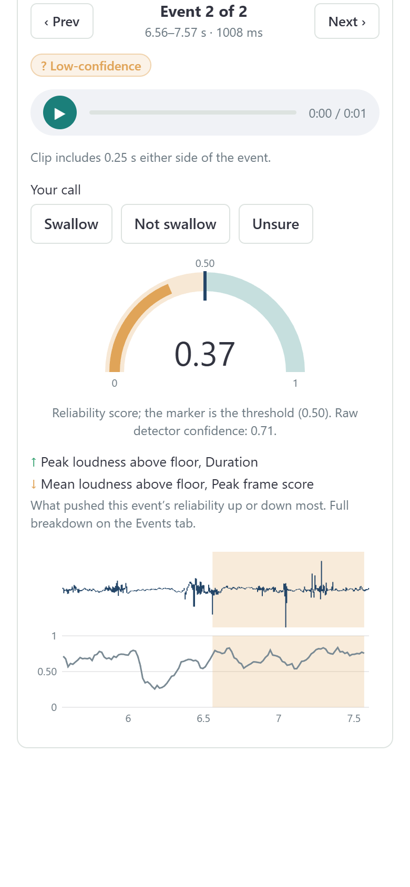 **Event card** |
| 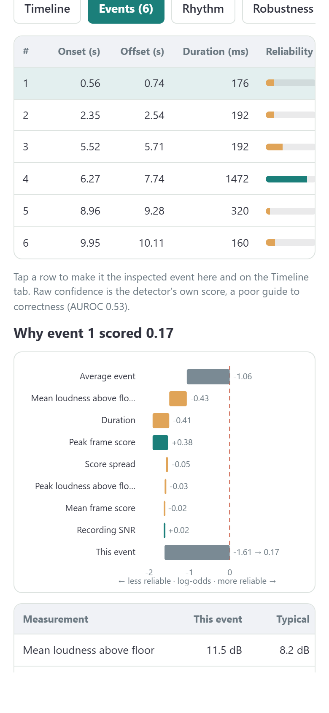 **Events** |  **Why this score?** | 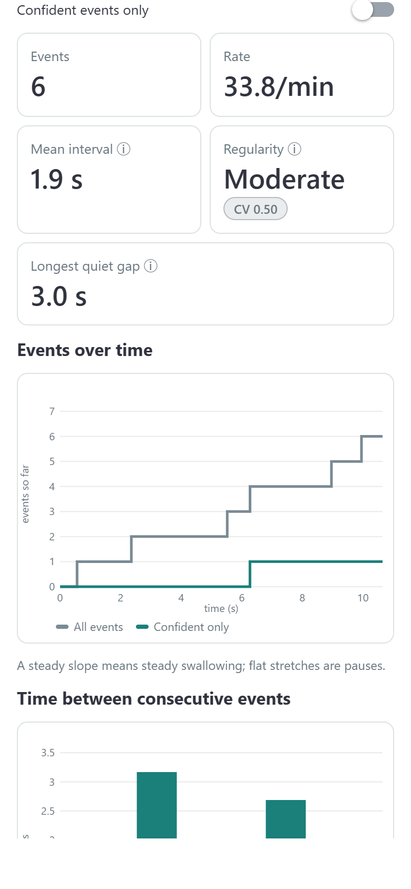 **Rhythm** |
| 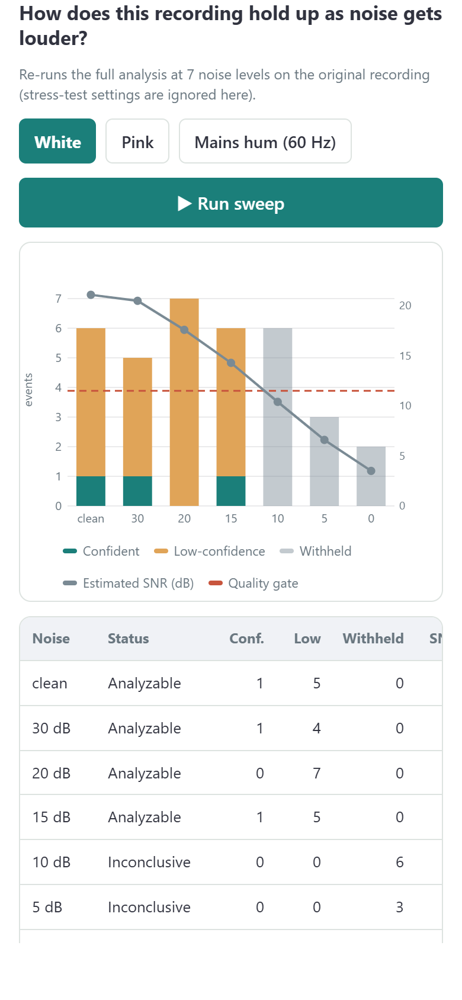 **Robustness lab** | 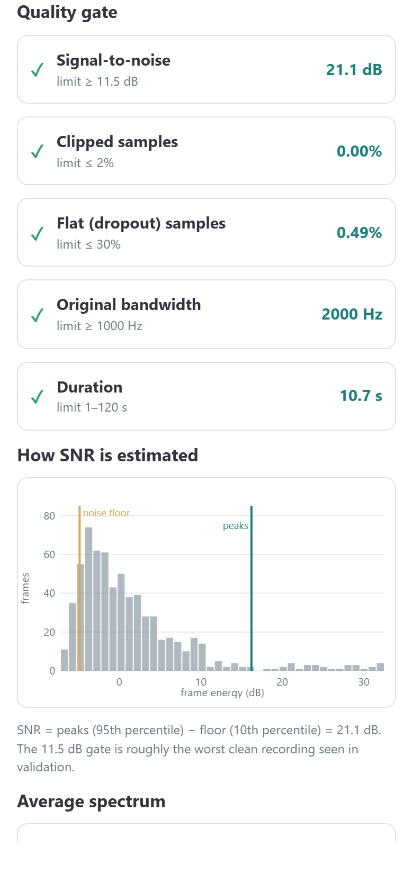 **Signal quality** | 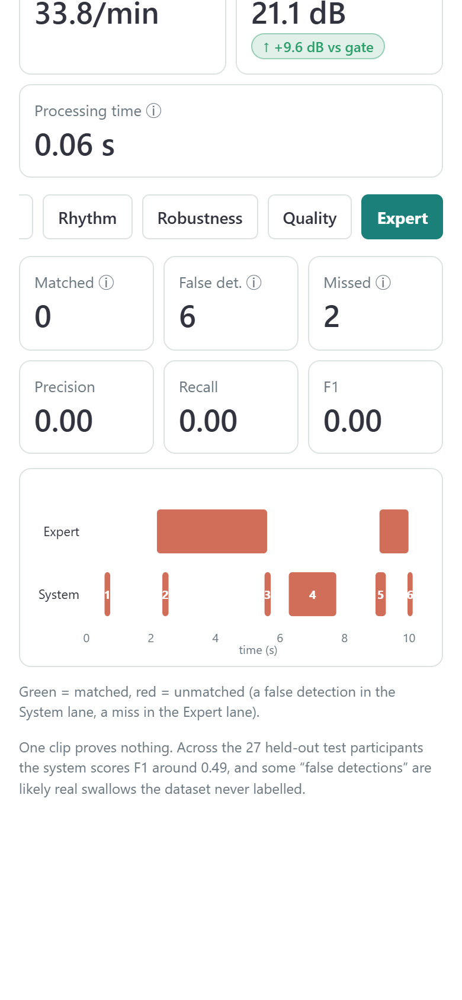 **Expert comparison** |
| 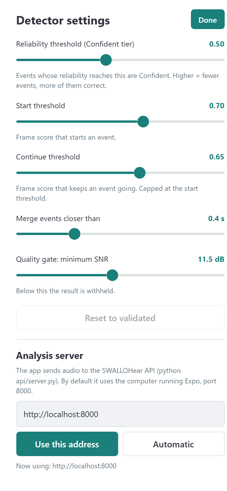 **⚙ Detector settings** | 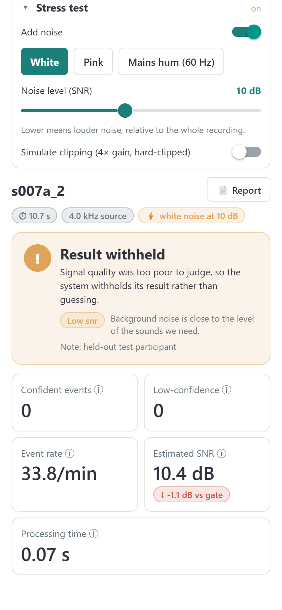 **Stress test → withheld** | 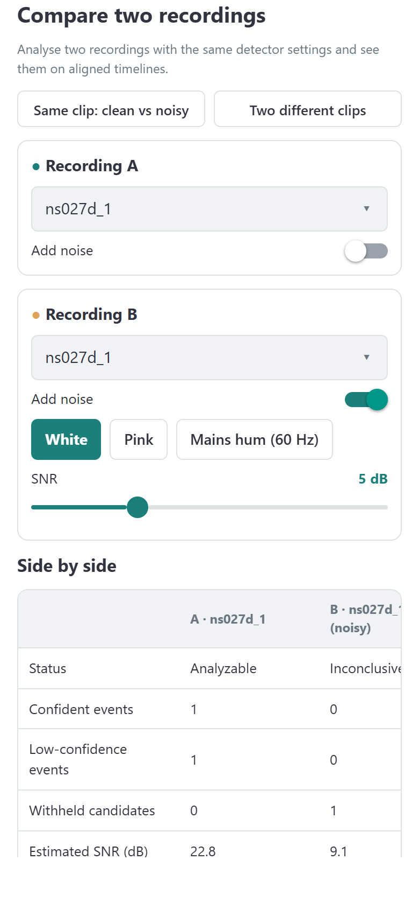 **Compare** |
| 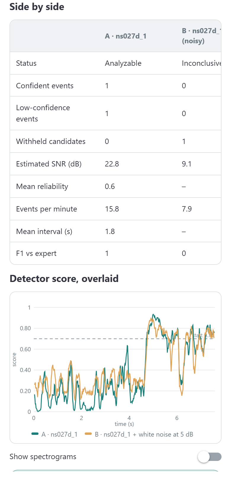 **Compare: side by side** | 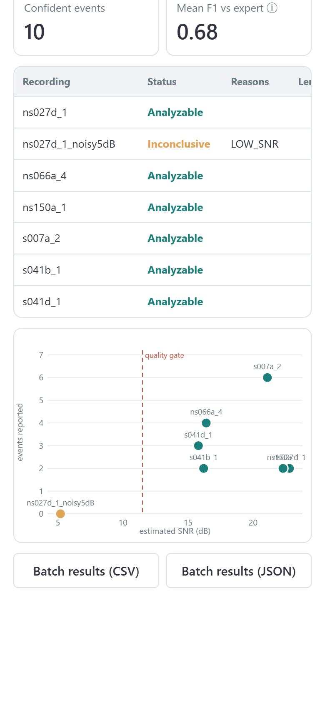 **Batch** | 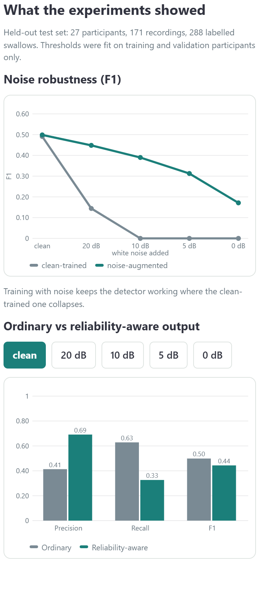 **Method & results** |

These screenshots come from the app's web build at phone size (390 × 844). On a real phone the navigation is the native
bottom tab bar instead of the top bar.

---

## Building installable apps

Expo Go is enough for development and demos. To make a standalone app, use EAS Build (no Android Studio or Xcode needed):

```bash
npx eas-cli@latest build --platform android --profile preview
```

Release builds can already talk to an `http://` server on the local network (`usesCleartextTraffic` on Android,
`NSAllowsLocalNetworking` on iOS, both set in `mobile/app.json`). For use outside the local network, host
`api/server.py` behind HTTPS and set its address under **⚙ → Analysis server**.

---

## Troubleshooting

| Symptom | Fix |
|---|---|
| "Can't reach the analysis server" | Start `python api/server.py` on the same computer as `npx expo start`, then reload the app. Under ⚙ → Analysis server, choose **Automatic**. |
| Expo Go: "The request timed out" | The phone can't reach the computer. After changing Wi-Fi, restart `npx expo start` and scan the **new** QR code (never reopen an old project from *Recently opened*). Many routers and Android hotspots block devices from talking to each other: use the computer's own **Mobile Hotspot** (Windows Settings → Network & internet), or your iPhone's **Personal Hotspot** with the computer joined to it. |
| A recording uploads but fails to decode | `pip install imageio-ffmpeg` in the venv (needed for M4A/AAC/WebM). |
| "Recording expired; load it again" | The server keeps the last 40 recordings in memory; restarting it clears them. Pick the clip again. |
| Microphone does nothing | Allow microphone access for Expo Go (or SWALLOHear) in the phone's settings. |

---

## Developer notes

| Path | What it is |
|---|---|
| `api/server.py` | HTTP API: `/api/meta`, `/api/load`, `/api/analyze`, `/api/sweep`, `/api/batch`, audio and report endpoints |
| `tests/test_api.py` | Starts the API and calls every endpoint, including an M4A upload |
| `mobile/src/app/` | Expo Router routes (one file per tab) |
| `mobile/src/screens/` | The four screens; `analyze/` holds the source panel and the seven tabs |
| `mobile/src/components/` | UI kit (`ui.tsx`), SVG charts (`charts.tsx`), audio player, header and settings sheet, tab bars |
| `mobile/src/lib/` | API client, app state (theme, settings, calls, session), theme colours, exports, rhythm maths |
| `scripts/capture_mobile.py` | Regenerates the phone screenshots (needs the API and `npx expo start --web --port 8081` running) |
| `mobile/scripts/make_icons.py` | Draws the app icon and splash image |

Checks: `npm run typecheck`, `npm run lint`, `npx expo-doctor`, and `python tests/test_api.py`.
