# SWALLOHear: A Reliability-Aware Acoustic Swallowing Analysis Research System for Post-Stroke Dysphagia

**Research paper and system documentation**

**Team RIPARION**: Jan Emmanuel Dela Cruz · Denver Reyes · Joshua Abalo · Rhaine Cyrel Valera · Jhayciel Santiago

Philippine Junior Data Science Challenge (PJDSC) 2026 · *Trace the Pattern, Target the Cure: Advancing Public Health Through Data Science*

October 2026 · Code, models and data pipeline: <https://github.com/jedelacruz/swallohear>

> **Research prototype, not a diagnostic device.** SWALLOHear detects swallowing-related sounds in neck-microphone
> audio and reports how far each result can be trusted. It does not diagnose dysphagia, aspiration or pneumonia, does not
> grade severity, and must not be used to make care decisions.

---

## Abstract

**Background.** About 42% of people with acute stroke develop dysphagia (difficulty swallowing), which is associated
with roughly four-fold higher odds of pneumonia and death (Banda et al., 2022). Instrumental swallowing tests need
X-ray equipment and specialists. Cervical auscultation, recording swallowing sounds at the neck, is cheap and
non-invasive, but automatic analysis of these sounds is rarely evaluated on unseen patients, on noisy recordings, or for
whether it knows when it is wrong.

**Methods.** We built SWALLOHear, a reliability-aware pipeline for neck-microphone audio, using the public *Swallowing
High Resolution Cervical Auscultation Signals* dataset (Khalifa et al., 2021). After auditing the files (1,090 usable
labelled recordings from 174 participants) we made a participant-disjoint 70/15/15 split, so no person appears in more
than one part. We compared an energy-threshold baseline with a Random Forest on 81 acoustic features, trained a
noise-augmented Random Forest, and added a reliability layer: a signal-quality gate that withholds results on poor
recordings, and a separately trained reliability model that scores each detected event. Every threshold was chosen on
validation participants; the 27 test participants (171 recordings, 288 swallows) were used once. Confidence intervals
come from a participant-level bootstrap.

**Results.** On clean audio the Random Forest reached event F1 0.50 (95% CI 0.40–0.59) against 0.28 (0.23–0.34) for
the energy baseline. A clean-trained model collapsed under white noise (F1 0.14 at 20 dB, 0.00 at 10 dB), while the
noise-augmented model kept 0.45, 0.39 and 0.31 at 20, 10 and 5 dB. The detector's own confidence barely separated
correct from wrong detections (AUROC 0.53, 0.46–0.60); the learned reliability score did (0.79, 0.73–0.83). Reporting
only events the reliability model calls *Confident* raised precision from 0.41 to 0.69 and cut false detections from
9.4 to 1.5 per minute, at the cost of recall (0.63 → 0.33). The quality gate withheld 2% of clean recordings and 82%
and 94% at 10 and 5 dB. Temperature scaling did not improve calibration. A 30-second clip is analysed in 0.13 s on a
laptop CPU.

**Conclusions.** Absolute accuracy is modest, but SWALLOHear makes its failures visible: it says when a recording is
too poor to judge and which detections to trust. It is delivered as an open repository, a web application and a
mobile application for Android and iOS, all running the same code.

**Keywords:** cervical auscultation; swallowing-event detection; post-stroke dysphagia; reliability; selective
prediction; signal quality; participant-independent validation; reproducible research.

---

## How to read this document

| If you are… | Read |
|---|---|
| A judge or reader who wants the research | Abstract, sections 1, 3, 4, 5, 8 |
| A clinician, therapist or student who wants to **use** the app | Section 2 (plain-language overview), then section 7 (user guide) |
| A developer who wants to run or extend it | Sections 6 and 7, and the appendices |

---

## Contents

1. [Introduction](#1-introduction)
2. [SWALLOHear in plain language](#2-swallohear-in-plain-language)
3. [Data](#3-data)
4. [Methods](#4-methods)
5. [Results](#5-results)
6. [The SWALLOHear system](#6-the-swallohear-system)
7. [User guide](#7-user-guide)
8. [Discussion](#8-discussion)
9. [Future work](#9-future-work)
10. [Conclusion](#10-conclusion)
11. [References](#references)
12. [Appendices](#appendices)

<div class="pagebreak"></div>

## 1. Introduction

### 1.1 Stroke and dysphagia

Difficulty swallowing is one of the most common complications of stroke. A meta-analysis of 42 studies with 26,366
patients found a pooled dysphagia prevalence of 42% in acute stroke. Affected patients had markedly higher odds of
pneumonia (odds ratio 4.08, 95% CI 2.13–7.79) and death (4.07, 2.17–7.63) (Banda et al., 2022). How often dysphagia is
found depends on how carefully it is looked for: 37–45% with screening, 51–55% with clinical testing and 64–78% with
instrumental testing (Martino et al., 2005). In the Philippines, reported stroke prevalence ranges from 0.5% to 6.0%
across studies (Collantes et al., 2022). Early, objective and affordable assessment of swallowing is therefore a
public-health research priority.

### 1.2 Cervical auscultation

The reference test, videofluoroscopy, films a patient swallowing under X-ray. It gives exact timing but needs equipment,
radiation and trained staff. Bedside screening is quick but coarse. **Cervical auscultation** records the sounds and
vibrations of swallowing at the neck with a microphone or accelerometer. The effect of dysphagia on these signals has
been reviewed (Dudik et al., 2018), and the hardware is cheap, which makes it an attractive basis for affordable
research tools, provided the analysis can be trusted.

Prior work on the same public data trained a deep neural network on spectrogram windows and reported per-record
sensitivity of 85.3% and specificity of 83.8% (Khalifa et al., 2020). That is strong work, with two features that shape
ours: its best channel was an accelerometer, not the microphone that a phone or stethoscope provides; and window-level
accuracy does not measure event start/end timing or tell a user when not to trust a detection.

### 1.3 The problem

Detecting that a swallow happened is not the same as measuring it reliably, and neither is the same as knowing when not
to trust the measurement. Three weaknesses limit current practice:

1. **Optimistic evaluation.** If recordings of the same person appear in both training and test data, results look
   better than they will on new patients (Saeb et al., 2017).
2. **Window-level reporting.** Accuracy on short windows hides errors in event start, end and duration, which feed into
   any downstream measure such as swallowing rate.
3. **Silent failure.** A noisy, clipped or low-quality recording can produce confident-looking but wrong output, and the
   user cannot tell. Modern models are often over-confident (Guo et al., 2017). This risk is greatest exactly where
   cheap tools are most needed: noisy bedside and low-resource settings.

### 1.4 Research questions and hypotheses

**Central question.** Under participant-disjoint evaluation, how accurately can a reliability-aware acoustic pipeline
find swallowing events in neck-microphone audio, and can it flag the detections and recordings that should not be
trusted?

- **RQ1 (localisation).** How do an energy baseline and machine-learning detectors compare in event-level F1 and
  start/end error on unseen participants?
- **RQ2 (reliability).** Do calibration, a learned reliability score and a signal-quality gate raise the precision of
  reported events and expose failures under noise, and what coverage is sacrificed?
- **RQ3 (accessibility).** How does performance degrade under noise, and can the whole workflow run interactively on a
  CPU, in a browser and on a phone?

Pre-specified hypotheses (from our proposal): **H1** a compact CNN beats the best conventional detector in event F1;
**H2** at 5 dB SNR, events labelled Confident have higher precision than unfiltered detections; **H3** temperature
scaling lowers expected calibration error. Their outcomes, including the negative ones, are in section 5.8.

### 1.5 Contributions

1. A **participant-disjoint, event-level evaluation** of microphone-only swallowing detection, with participant-level
   bootstrap confidence intervals and a self-checking reproduction script.
2. A **reliability layer**: a data-driven signal-quality gate plus a learned event-reliability model that is far better
   than the detector's own confidence at telling right from wrong, with an exact per-event explanation.
3. Evidence that **noise-augmented training** prevents the collapse of a clean-trained detector under noise.
4. An **open, usable tool**: a web application, a mobile application for Android and iOS, and an HTTP API, all running
   the same code as the experiments.

### 1.6 Scope

| SWALLOHear does | SWALLOHear does not |
|---|---|
| Detect and time swallowing-related acoustic events in compatible recordings | Diagnose dysphagia, aspiration or pneumonia |
| Report signal quality and withhold results it cannot trust | Grade severity or predict outcomes |
| Score and explain how trustworthy each detection is | Claim clinical or Philippine validation |
| Measure swallowing rhythm and agreement with expert labels | Replace videofluoroscopy or a clinician |

<div class="pagebreak"></div>

## 2. SWALLOHear in plain language

*This section is for readers without a technical background.*

### 2.1 What it does, in one minute

You give SWALLOHear a sound recording made with a microphone resting against the side of the throat. It:

1. **Checks whether the recording is good enough.** If it is too noisy, distorted, too short or too long, SWALLOHear
   says **"Result withheld"** and explains why, instead of guessing.
2. **Finds the swallowing sounds.** It marks where each one starts and ends, like highlighting words in a sentence.
3. **Says how much to trust each one.** Every detected sound gets a **reliability score** from 0 to 1. Scores of 0.50 or
   more are **Confident**; lower scores are **Low-confidence** ("check this one yourself").
4. **Explains itself.** For any detection it shows which measurements pushed the score up or down.
5. **Summarises.** It counts events, measures the rhythm of swallowing, compares with an expert's labels when they exist,
   and lets you download everything or print a report.

### 2.2 The four possible verdicts

| Verdict | What it means | What to do |
|---|---|---|
| ✓ **Events detected** | The recording was good enough, and swallowing-related sounds were found. | Look at each event's tier (Confident or Low-confidence). |
| ○ **No event detected** | The recording was good enough, but nothing looked like a swallow. | This does not prove no swallow happened. |
| ! **Result withheld** (Inconclusive) | The recording was too poor to judge. The reason is shown (e.g. *Low SNR*: too noisy). | Record again in a quieter place, or adjust the microphone. |

Within "Events detected", each event is either **Confident** (teal) or **Low-confidence** (amber).

### 2.3 Key words

| Word | Meaning |
|---|---|
| **Event** | One detected swallowing-related sound, with a start time, end time and duration. |
| **SNR** (signal-to-noise ratio) | How much louder the swallowing sounds are than the background noise, in decibels (dB). Higher is better; the app needs about 11.5 dB. |
| **Reliability score** | A number from 0 to 1 saying how likely an event is to be a real, correctly placed swallow. |
| **Expert labels** | The swallow times marked by specialists from X-ray video, available for the demo clips. |
| **Precision** | Of the events the app reports, the share that are real. |
| **Recall** | Of the real swallows, the share the app finds. |
| **F1** | One number combining precision and recall (1.0 is perfect, 0 is useless). |

### 2.4 Why "knowing when not to trust" matters

A tool that is right half the time but cannot tell which half is hard to use. SWALLOHear's main idea is to separate the
detections it can stand behind from those it cannot, and to refuse to answer on recordings it cannot read. When it says
*Confident*, it is right about 7 times in 10 on clean test recordings; when it reports everything, it is right about 4
times in 10 (section 5.3).

<div class="pagebreak"></div>

## 3. Data

### 3.1 Source

We used **Swallowing High Resolution Cervical Auscultation Signals** (Khalifa, Donohue, Coyle & Sejdić, 2021; University
of Pittsburgh; Zenodo, DOI 10.5281/zenodo.4539695; licence CC BY 4.0). It contains swallowing recordings from patients
referred for videofluoroscopy, with swallow start and end times marked on the synchronised X-ray video. No new patient
data were collected for this study.

### 3.2 What the files contain

| Item | Detail |
|---|---|
| Signals | `signals/<id>.npy`: an *N* × 4 array sampled at 4 kHz. Channel 0 is the **microphone** (our input); channels 1–3 are a three-axis accelerometer (anterior–posterior, superior–inferior, medial–lateral). |
| Labels | `labels/<id>.csv`: one row per swallow with start and end **video frame numbers at 60 frames/s**. |
| Time conversion | sample = frame × 4000 / 60, so label resolution is about **17 ms**. Timing differences smaller than that are not meaningful. |
| Recording names | e.g. `ns011a_1`. The prefix `ns` or `s` marks two participant groups whose meaning (for example stroke) is **not documented**; we never treat them as stroke labels. |

### 3.3 Data audit

The record page describes 248 patients and 3,144 swallows. The files we downloaded (MD5 checksums verified) contain fewer,
and we report what the files contain:

| Quantity | Count |
|---|---|
| Signal files | 1,285 recordings |
| Recordings with a label file | 1,092 (174 participants, 1,876 labelled swallows) |
| Recordings passing sanity checks (labels inside the signal, start < end) | **1,090** (2 excluded) |
| Recordings without labels | 193, used only as extra negative examples in training |
| Participant groups (`ns` / `s`) | 139 / 35 participants |
| Recording length | median 7.8 s (interquartile range 5.1–11.9 s), longest 45.6 s |

### 3.4 Participant-disjoint split

All recordings of one person stay in one part: **training** (fit the models), **validation** (choose every threshold and
setting) or **test** (sealed, used once for the reported numbers). The split is seeded and reproducible
(`scripts/build_index.py`), and a unit test checks that the parts share no participant.

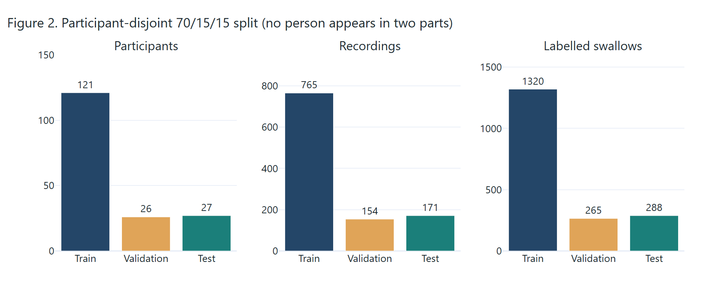

### 3.5 Demo clips

Seven short clips from **test** participants ship with the apps in `data/demo/` (CC BY 4.0, with attribution), each
with its expert labels. One (`ns027d_1_noisy5dB`) has white noise added at 5 dB to show the quality gate.

<div class="pagebreak"></div>

## 4. Methods

### 4.1 Overview

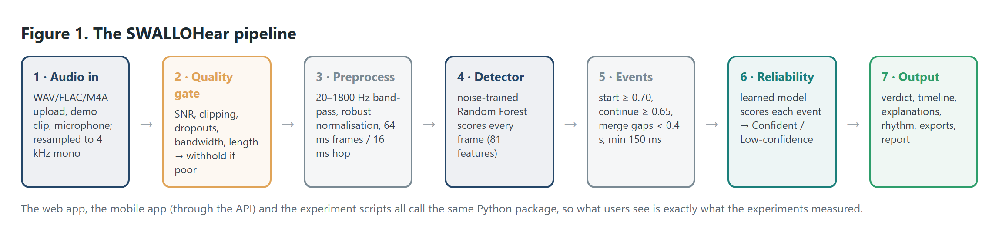

The same Python package (`src/swallohear`) is used by the experiment scripts, the web app and the mobile app's API, so
what users see is exactly what was evaluated.

### 4.2 Audio loading and preprocessing

| Step | Setting |
|---|---|
| Loading | WAV or FLAC (web); also M4A, AAC, MP3, WebM through the API. Stereo is averaged to mono. |
| Resampling | Any rate → 4 kHz with an anti-aliasing polyphase filter; the original rate is kept to check bandwidth. |
| Band-pass filter | 4th-order Butterworth, 20–1,800 Hz, zero-phase, to remove drift and very high frequencies. |
| Normalisation | Robust per-recording scaling (median and median absolute deviation), so microphone gain does not dominate. |
| Framing | 64 ms frames (256 samples), 16 ms hop. |

### 4.3 Signal-quality gate

Before trusting any detection, each recording is checked. If any check fails the verdict is **Inconclusive** and the
candidate events are shown only for inspection.

| Check | Limit | Reason code |
|---|---|---|
| Estimated SNR = 95th minus 10th percentile of frame energy | ≥ 11.5 dB | `LOW_SNR` |
| Clipped samples (at the maximum amplitude) | ≤ 2% | `CLIPPING` |
| Flat samples (signal not changing) | ≤ 30% | `FLATLINE` |
| Original bandwidth (half the original sample rate) | ≥ 1,000 Hz | `LOW_BANDWIDTH` |
| Duration | 1–120 s | `TOO_SHORT` / `TOO_LONG` |

The SNR limit is data-driven: it is the **5th percentile of clean validation recordings**, roughly the worst clean
recording the system saw while being tuned.

### 4.4 Acoustic features

For every frame the Random Forest receives **81 features**: 27 base measurements, plus their mean and standard deviation
over ±5 neighbouring frames (176 ms of context).

| Base features (27) | |
|---|---|
| Loudness and texture | log RMS energy, zero-crossing rate |
| Spectral shape | centroid, bandwidth, 85% roll-off, flatness |
| Band energies | log energy in 8 bands: 20–100, 100–200, 200–350, 350–500, 500–800, 800–1,200, 1,200–1,600, 1,600–2,000 Hz |
| Timbre | 13 mel-frequency cepstral coefficients (20 mel bands, 20–1,900 Hz) |

### 4.5 Detectors

| Detector | Description |
|---|---|
| **M0 energy baseline** | Short-time energy in 100–1,000 Hz, smoothed over 9 frames, compared with an adaptive threshold (noise floor + 3 × median absolute deviation). |
| **M1 Random Forest (clean-trained)** | 100 trees, class-balanced, minimum 50 samples per leaf, on the 81 features. Trained on training participants; 25% of non-swallow frames kept to balance classes; unlabelled recordings add negatives. |
| **M1 Random Forest (noise-augmented)**, the final detector | Same model, but each training recording is used clean **and** with white noise at a randomly chosen 20, 10 or 5 dB. |

A compact CNN (M2) was planned in the proposal but **not built** in the time available; the noise-augmented Random Forest
is the final detector.

### 4.6 From frame scores to events

All detectors share the same post-processing (*hysteresis*): an event **starts** when the frame score reaches the start
threshold, **continues** while it stays above the continue threshold, events closer than the merge gap are joined, and
events shorter than 150 ms are dropped. Values chosen on validation:

| Setting | M0 | Final Random Forest |
|---|---|---|
| Start threshold | 0.30 | **0.70** |
| Continue threshold | 0.10 | **0.65** |
| Merge gap | 0.4 s | **0.4 s** |
| Minimum duration | 150 ms | **150 ms** |

### 4.7 The reliability layer

**First attempt (did not work well).** We first followed the proposal: temperature-scale the detector's frame scores,
use the mean calibrated score of an event as its confidence, and choose a threshold on validation. Calibration barely
changed (section 5.3.4), and the best threshold kept only 16% of real swallows at precision 0.44: raw confidence simply
does not know when it is wrong.

**Final approach: a learned reliability model.** We trained a second model whose only job is to predict whether a
detected event is correct (overlaps an expert label by at least half). For each event it sees seven measurements:

| # | Measurement | Meaning |
|---|---|---|
| 1 | Mean frame score | Average detector score inside the event |
| 2 | Peak frame score | Highest detector score inside the event |
| 3 | Score spread | Standard deviation of the score inside the event |
| 4 | Duration | Event length in seconds |
| 5 | Mean loudness above floor | Average frame energy minus the recording's noise floor (dB) |
| 6 | Peak loudness above floor | Loudest frame minus the noise floor (dB) |
| 7 | Recording SNR | Estimated signal-to-noise ratio of the whole recording (dB) |

The model is a **standardised logistic regression**, trained on events from **training participants only**, using
3-fold participant-grouped *out-of-fold* predictions (so it learns from detections the detector made on people it had
not been trained on), on clean audio and at 20, 10 and 5 dB. The **Confident** threshold τ was chosen on validation by a
pre-set rule: the highest τ in {0.2, …, 0.7} that raises precision by at least 0.10 over ordinary output while keeping at
least 25% of detections. This gave **τ = 0.50**.

### 4.8 Explaining a score

Because the reliability model is a standardised logistic regression, every score is an exact sum:

```
log-odds = intercept + Σ  weightᵢ × (valueᵢ − averageᵢ) / spreadᵢ          reliability = 1 / (1 + e^(−log-odds))
```

The intercept is the score of an *average* event; each term is the push from one measurement. The app's **"Why this
score?"** chart draws exactly these terms (a waterfall), and they add up to the reliability score shown. We verified this
numerically for every event of three demo clips.

### 4.9 Swallowing rhythm

From the detected events the app reports the event rate per minute, the intervals between consecutive onsets, their
mean, the **regularity** (coefficient of variation of the intervals: < 0.25 steady, 0.25–0.5 moderate, > 0.5 irregular)
and the longest quiet gap, including the start and end of the recording. Rhythm is descriptive only.

### 4.10 Evaluation protocol

- **Event matching.** A detection is a true positive if it overlaps an unmatched expert label with intersection-over-union
  (IoU) ≥ 0.5, matched one-to-one (Mesaros et al., 2016). IoU ≥ 0.3 is also reported for the detectors.
- **Metrics.** Precision, recall, F1, false detections per minute, signed and absolute onset/offset error, AUROC for
  "is this detection correct", expected calibration error (ECE, 15 equal-mass bins).
- **Noise.** White noise added to test recordings at 20, 10, 5 and 0 dB SNR relative to the power inside labelled
  swallows (fixed seeds).
- **Uncertainty.** 95% confidence intervals from a participant-level cluster bootstrap (resampling the 27 test
  participants), with `scripts/bootstrap_ci.py`, which also re-computes the main F1 and checks it matches the main run
  (all four noise levels: "OK").
- **One look at the test set.** All thresholds, τ and the SNR limit were fixed on validation before testing.

<div class="pagebreak"></div>

## 5. Results

All results are on the **27 held-out test participants (171 recordings, 288 labelled swallows)** and come from
`results/*.json`.

### 5.1 Detecting swallows on clean audio (RQ1)

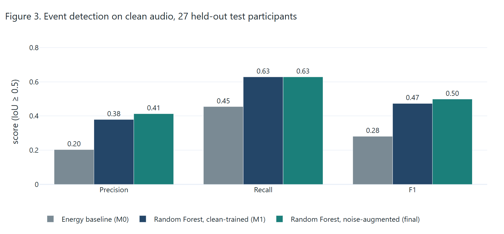

| Detector (IoU ≥ 0.5) | Precision | Recall | F1 (95% CI) | False detections / min |
|---|---|---|---|---|
| M0 energy baseline | 0.20 | 0.45 | 0.28 (0.23–0.34) | 18.8 |
| M1 Random Forest, clean-trained | 0.40 | 0.63 | 0.49 (0.39–0.59) | 9.7 |
| **M1 Random Forest, noise-augmented (final)** | **0.41** | **0.63** | **0.50 (0.40–0.59)** | **9.4** |

With the looser IoU ≥ 0.3 match (baseline script, `results/baselines.json`, which uses a continue threshold of 0.60), F1
is 0.45 for M0 and 0.59 for the Random Forest. On clean audio, noise-augmented and
clean-trained Random Forests are tied (difference +0.007, 95% CI −0.012 to +0.027): augmentation costs nothing on clean
audio.

**Timing** (same baseline script). For matched events, the Random Forest's median start error was −57 ms (it fires slightly early) and median
end error −22 ms; median absolute errors were 113 ms (start) and 122 ms (end). The energy baseline's were 121 ms and
202 ms. Remember that labels themselves have about 17 ms resolution.

### 5.2 Robustness to noise (RQ3)

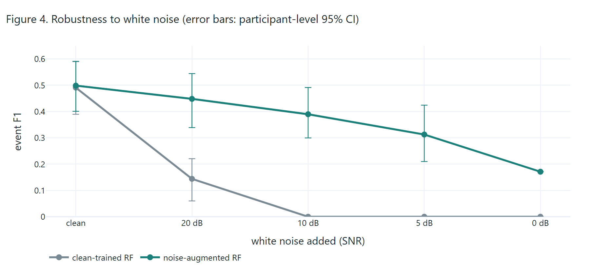

| White noise | Clean-trained RF F1 (95% CI) | Noise-augmented RF F1 (95% CI) | Gain (95% CI) |
|---|---|---|---|
| none | 0.49 (0.39–0.59) | 0.50 (0.40–0.59) | +0.01 (−0.01 to +0.03) |
| 20 dB | 0.14 (0.06–0.22) | **0.45 (0.34–0.54)** | +0.30 (0.24–0.38) |
| 10 dB | 0.00 | **0.39 (0.30–0.49)** | +0.39 (0.30–0.49) |
| 5 dB | 0.00 | **0.31 (0.21–0.42)** | +0.31 (0.21–0.42) |
| 0 dB | 0.00 | 0.17 | – |

A detector trained only on clean audio stops working as soon as moderate noise is added. Training with noise keeps it
usable down to about 5 dB.

### 5.3 Does SWALLOHear know when it is wrong? (RQ2)

#### 5.3.1 Raw confidence vs the learned reliability score

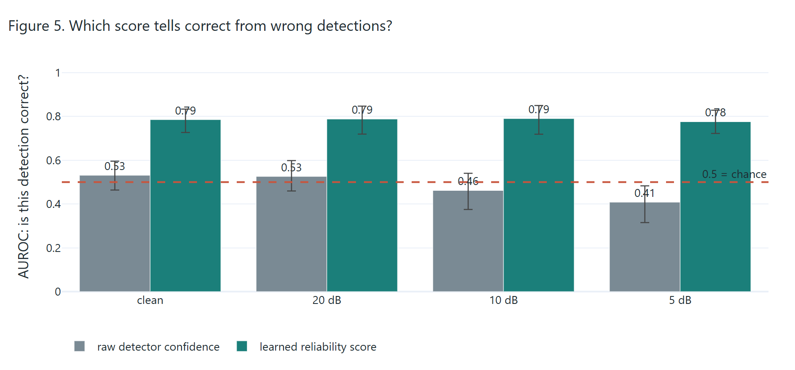

AUROC measures how well a score ranks correct detections above wrong ones (0.5 = coin flip, 1.0 = perfect).

| Noise | Raw detector confidence | Learned reliability score | Difference (95% CI) |
|---|---|---|---|
| none | 0.53 (0.46–0.60) | **0.79 (0.73–0.83)** | +0.25 (0.17–0.34) |
| 20 dB | 0.53 (0.46–0.60) | **0.79 (0.72–0.85)** | +0.26 (0.16–0.37) |
| 10 dB | 0.46 (0.38–0.54) | **0.79 (0.72–0.85)** | +0.33 (0.23–0.42) |
| 5 dB | 0.41 (0.32–0.48) | **0.78 (0.72–0.83)** | +0.37 (0.28–0.47) |

The detector's own confidence is barely better than chance on clean audio and becomes *worse* than chance in noise. The
learned score stays at about 0.78–0.79 at every level, and every difference is clearly above zero.

#### 5.3.2 Ordinary vs reliability-aware output

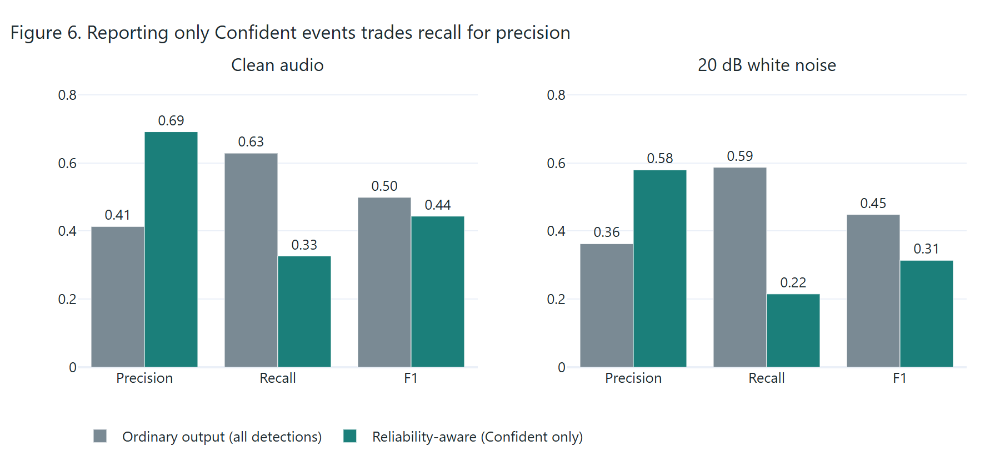

| Condition | Output | Reported events | Precision (95% CI) | Recall | F1 | False detections / min |
|---|---|---|---|---|---|---|
| Clean | Ordinary (all detections) | 438 | 0.41 (0.32–0.51) | 0.63 | 0.50 | 9.4 |
| Clean | **Reliability-aware** (Confident only) | 136 | **0.69 (0.59–0.78)** | 0.33 | 0.44 | **1.5** |
| 20 dB | Ordinary | 466 | 0.36 (0.26–0.46) | 0.59 | 0.45 | 10.9 |
| 20 dB | **Reliability-aware** | 107 | **0.58 (0.42–0.70)** | 0.22 | 0.31 | **1.6** |

Reporting only Confident events raises precision by about 0.28 and removes about 8 false detections per minute (95% CI
6.2–9.8), but finds about half as many real swallows. **This is a trade-off, not a free improvement**: it suits uses
where a false alarm is worse than a miss.

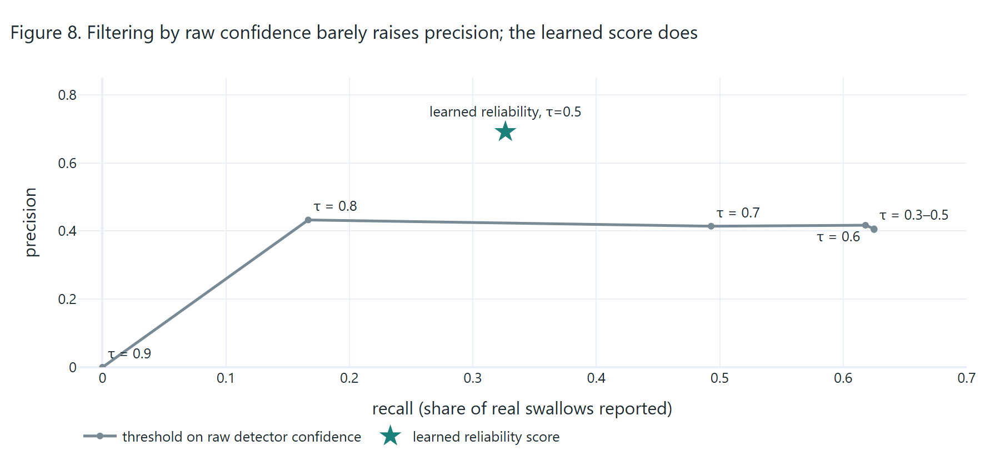

Raising a threshold on the detector's own confidence cannot reach this point: its precision stays near 0.41–0.43 whatever
the threshold (Figure 8).

#### 5.3.3 The quality gate under noise

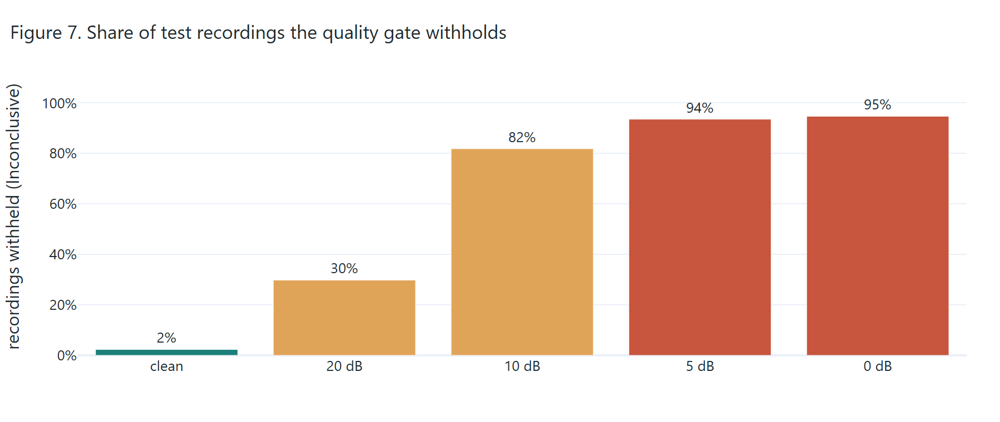

| Noise | none | 20 dB | 10 dB | 5 dB | 0 dB |
|---|---|---|---|---|---|
| Recordings withheld (Inconclusive) | 2% | 30% | 82% | 94% | 95% |

On clean audio the gate almost never interferes. As noise rises, it withholds most recordings, so at 10 dB and below the
system mostly refuses to answer instead of reporting results it cannot trust (12 events reported at 10 dB, 3 at 5 dB).

#### 5.3.4 Calibration

Temperature scaling did not fix calibration: the Random Forest's frame-level ECE went from 0.224 to 0.219, and the energy
baseline's got worse (0.061 → 0.114). The learned reliability score has an event-level ECE of 0.14 on clean audio and
0.09–0.13 under noise.

### 5.4 Microphone vs accelerometer

Using the anterior–posterior accelerometer instead of the microphone gave F1 0.47 against 0.49: **no advantage** in this
pipeline, which supports microphone-only (phone or stethoscope) research.

### 5.5 Participant groups

F1 of the final detector was 0.50 for the `ns` group and 0.49 for the `s` group on clean audio. Because the meaning of
these groups is not documented, **no stroke-specific conclusion is drawn**.

### 5.6 What the reliability model learned

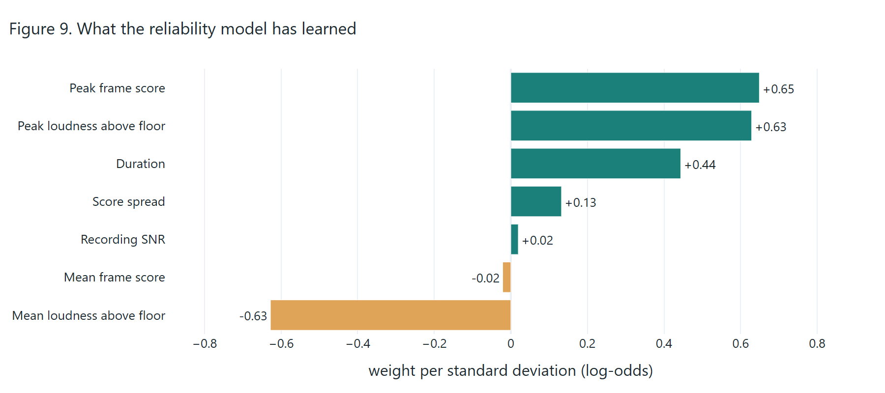

Events are judged more reliable when the detector's **peak** score is high, the event has a clear **loud peak** above the
noise floor and it **lasts longer**. A high *average* loudness lowers reliability: broad, uniformly loud stretches tend to
be noise or speech rather than a swallow. The detector's mean score (its "confidence") carries almost no weight, which is
consistent with section 5.3.1.

### 5.7 Speed (RQ3)

Analysing a 30-second recording took a **median 0.13 s** (20 runs, maximum 0.16 s) on a laptop CPU (AMD Ryzen 5 6600H),
about 236 times faster than real time. The proposal's target was ≤ 5 s.

### 5.8 Hypotheses and objectives

| Hypothesis | Outcome |
|---|---|
| **H1** CNN beats the best conventional detector | **Not tested**: the CNN was not built. The Random Forest clearly beat the energy baseline (F1 0.50 vs 0.28; confidence intervals do not overlap). |
| **H2** At 5 dB, Confident events have higher precision than all detections | **Not supported at 5 dB**: the gate withholds 94% of recordings, so only 3 events were reported and precision cannot be estimated. **Supported at clean and 20 dB** (0.41 → 0.69 and 0.36 → 0.58). |
| **H3** Temperature scaling lowers calibration error | **Not supported** (0.224 → 0.219 for the Random Forest; worse for the baseline). A learned reliability model was needed instead. |

| Objective (proposal) | Status |
|---|---|
| O1 Data audit (checksums, parse all files, log exclusions) | Done: section 3.3 |
| O2 Detectors with event metrics on a sealed test set | Done for M0 and M1; M2 (CNN) not built |
| O3 Comparison with participant-level bootstrap CIs and ablations | Done: noise augmentation and sensor channel; filter and context-length ablations not run |
| O4 Calibration, risk–coverage, noise at 20/10/5/0 dB, quality index | Done (Brier score not reported) |
| O5 Web application (≥ 6 demo clips, uploads, four-state output, exports, ≤ 5 s latency) | Done (7 clips, 0.13 s), plus a mobile app and API beyond the proposal |
| O6 Reproducibility (pinned environment, seeds, split, tests) | Done; the split is regenerated deterministically rather than shipped as a file; no single `make` command yet |

<div class="pagebreak"></div>

## 6. The SWALLOHear system

### 6.1 Architecture

```
  Web browser ──► Streamlit web app (app/) ───────────────┐
                                                           ├──► swallohear package (src/) ──► trained models (models/)
  Phone (Android / iOS) ──► Expo app (mobile/) ──► HTTP API (api/server.py) ─┘
```

| Component | Technology | Role |
|---|---|---|
| Core package `src/swallohear/` | Python, NumPy, SciPy, scikit-learn | Loading, preprocessing, features, detectors, quality gate, reliability (`final.py`) |
| Web app `app/` | Streamlit, Plotly | Four pages, all features, runs the models in-process |
| HTTP API `api/server.py` | Starlette, uvicorn, imageio-ffmpeg | Serves the same analysis to the mobile app; decodes phone audio |
| Mobile app `mobile/` | Expo SDK 58, React Native, react-native-svg, expo-audio | Android, iOS and web from one codebase |

To keep interaction instant, the analysis is split into a slow step (preprocessing, quality and the Random Forest,
cached per recording) and a fast step (gate, events, reliability). Moving a threshold slider re-runs only the fast step.

### 6.2 The web app

The web app has four pages in a top navigation bar, a sidebar for inputs and settings, and a light/dark switch.

#### Analyze page

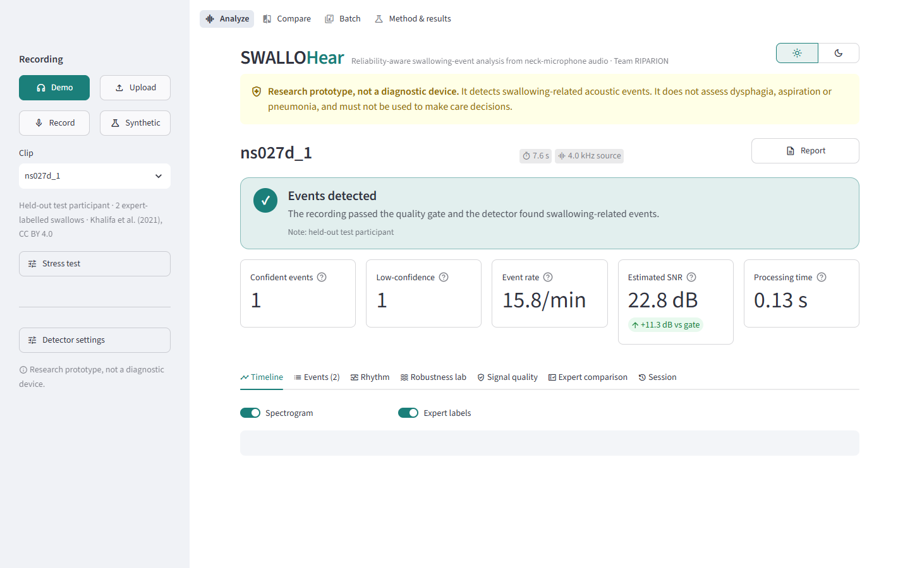

| Area | What it does |
|---|---|
| **Recording** (sidebar) | Choose **Demo**, **Upload**, **Record** (microphone) or **Synthetic** (generated test bursts). |
| **Stress test** (sidebar) | Add white, pink or 60 Hz mains-hum noise at any SNR, or simulate clipping, to see how the system reacts. |
| **Detector settings** (sidebar) | Live sliders for the reliability threshold, start and continue thresholds, merge gap and minimum SNR; **Reset to validated**. |
| **Verdict banner** | Events detected / No event / Result withheld, with reason codes. |
| **Summary cards** | Confident events, low-confidence events, event rate, estimated SNR vs the gate, processing time. |
| **Report** button | Downloads the printable report (section 6.5). |

The page has seven tabs:

**Timeline.** Waveform, spectrogram and detector score on one zoomable time axis. Shaded bands are events (teal =
Confident, amber = Low-confidence); dotted green outlines are expert labels. Click a numbered marker to inspect an event.

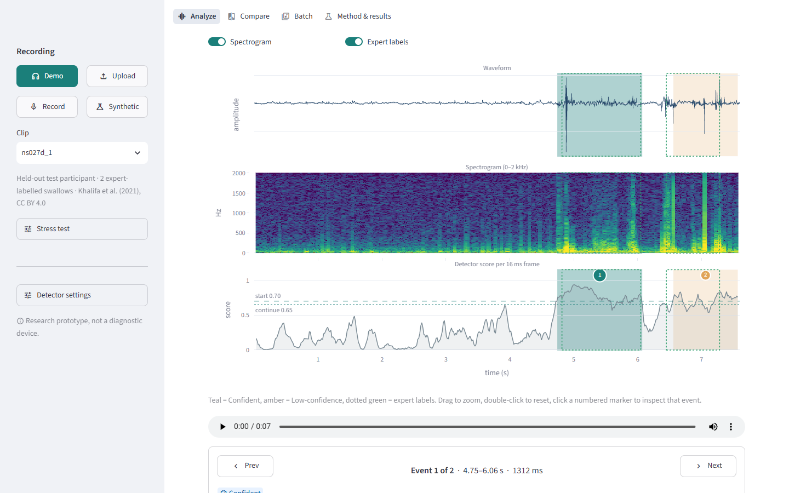

**Event card** (under the timeline): play just that event, see its reliability gauge against the threshold, the top
reasons (↑ raised / ↓ lowered), a zoomed view, and record **your call**: Swallow, Not swallow or Unsure.

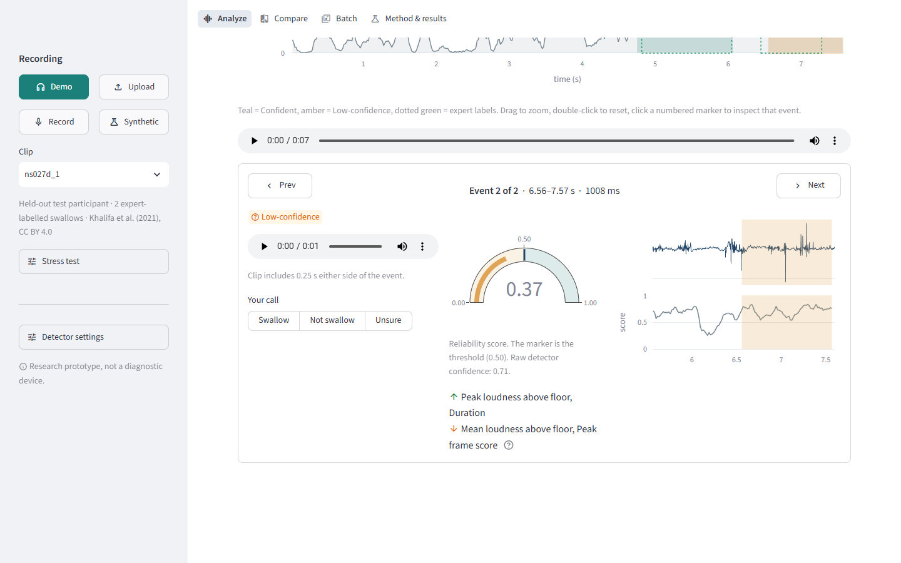

**Events.** A sortable table of all events; select a row to inspect it. **Why this score?** shows the exact waterfall
breakdown (section 4.8) and a table of this event's measurements against a typical event.

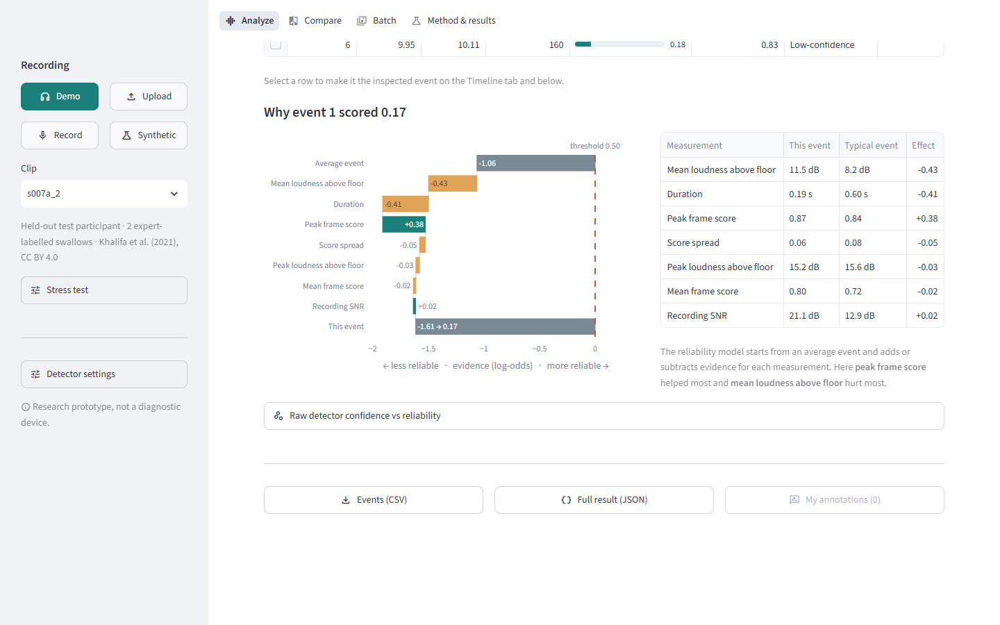

**Rhythm.** Number of events, rate, mean interval, regularity and longest quiet gap, with *events over time* and
*time between events* charts and a "Confident only" switch.

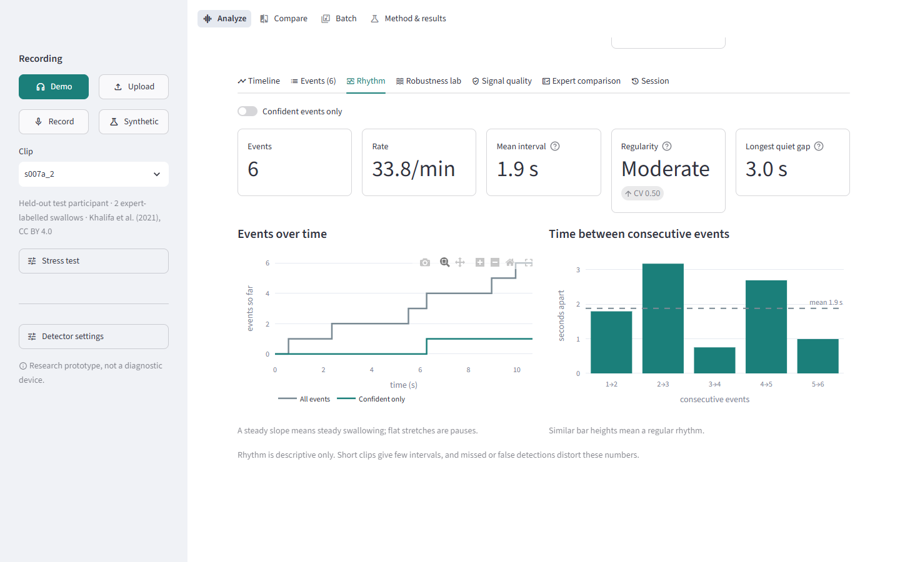

**Robustness lab.** Re-analyses the recording at seven noise levels (clean, 30, 20, 15, 10, 5, 0 dB) and shows how the
events change and where the gate starts withholding.

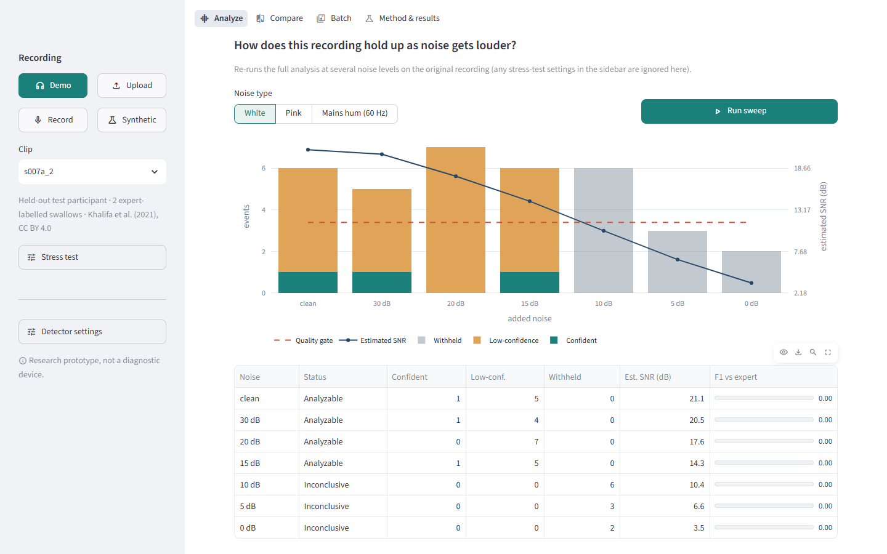

**Signal quality.** Every gate check with its value and limit, a histogram explaining the SNR estimate, and the average
spectrum (mains hum shows as spikes at 60, 120, 180 Hz).

**Expert comparison.** For labelled clips: matched events, false detections, misses, precision, recall, F1, timing error
and *Expert vs System* lanes.

**Session.** Every analysis run in this session, with exports of the log and all your calls.

#### Stress test in action

Adding 10 dB white noise to a clean clip drops its estimated SNR below the gate, and the verdict becomes **Result
withheld** with the reason *Low SNR*:

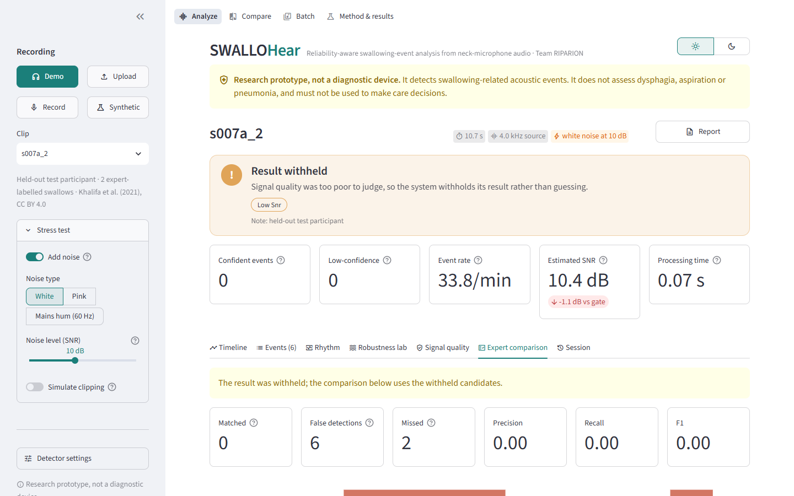

#### Compare, Batch and Method pages

| Page | What it does |
|---|---|
| **Compare** | Two recordings, or one clip clean vs noisy, side by side: a comparison table with a B − A column, both detector scores overlaid, and aligned timelines. |
| **Batch** | Analyse many recordings (demo clips and/or uploads, optional noise) in one go: totals, a sortable table, an SNR-vs-events chart and CSV/JSON export. |
| **Method & results** | The pipeline and interactive charts of the experiment results. |

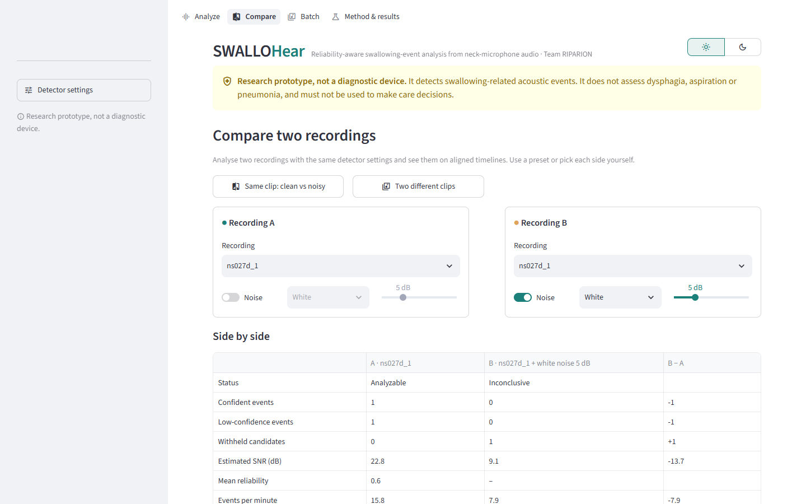
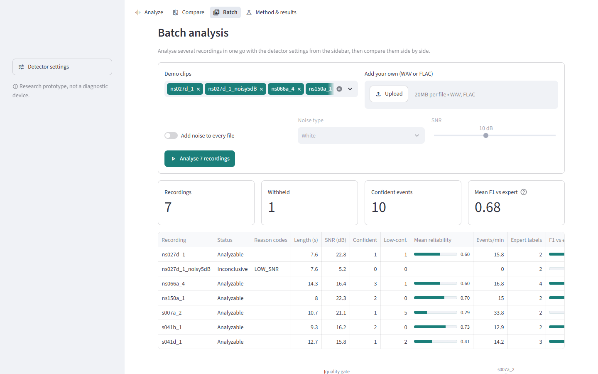

### 6.3 The mobile app

The mobile app (Android and iPhone, built with Expo) has **every web feature**, in the same colours and layout ideas,
adapted for touch: a bottom tab bar (Analyze, Compare, Batch, Method), a **☀/☾** theme switch and a **⚙** settings
sheet in the header, tappable event markers with 1–8× zoom, and the phone's share sheet for exports. It can record
directly from the phone's microphone. A captioned video walkthrough of all 21 mobile features, with per-feature clips and
snapshots, is in [`docs/mobile-demo/`](mobile-demo/README.md).

<p>


</p>
<p>


</p>

The phone sends the audio to the API on the computer, which runs the same Python models, so results are identical to the
web app. The Expo dev server forwards the app's `/api/` requests to the API, so the app reaches the analysis through the
same connection it was loaded from, with nothing to configure.

### 6.4 The HTTP API

| Endpoint | Purpose |
|---|---|
| `GET /api/health` | Is the server running? |
| `GET /api/meta` | Validated settings, demo clips, feature names, experiment results |
| `POST /api/load` | Load a demo clip, synthetic signal or uploaded file (any common audio format); returns a recording id |
| `POST /api/analyze` | Analyse a loaded recording with given settings and stress test; returns everything the screens show |
| `POST /api/sweep` | Robustness lab: analyse at seven noise levels |
| `POST /api/batch` | Batch analysis |
| `GET /api/analysis/{id}/audio.wav` | The analysed audio, or one event's clip (`?t0=&t1=`) |
| `POST /api/analysis/{id}/notes`, `GET …/report.html` | Save your calls and open the printable report |

### 6.5 Exports and the report

| Export | Contents |
|---|---|
| Events (CSV) | One row per event: times, duration, reliability, raw confidence, tier, your call |
| Full result (JSON) | Status, reasons, settings, stress test, events, withheld candidates, quality, annotations |
| My annotations / All annotations (CSV) | Only the events you gave a call |
| Session log (CSV) | Every analysis in the session |
| Batch results (CSV / JSON) | One row per recording |
| **Report (HTML → PDF)** | Disclaimer, verdict, summary, timeline, events over time, event table with reasons and your calls, rhythm, expert agreement, quality gate, settings and limitations. Works offline; open it and print to PDF. |

### 6.6 Privacy and security

Audio is processed in memory and is not written to disk or logged; the API keeps only the last 40 recordings in memory
and forgets them on restart. File type, size (≤ 20 MB) and length (≤ 120 s) are checked. There are no accounts. The apps
warn users not to upload identifiable patient audio to a shared server.

<div class="pagebreak"></div>

## 7. User guide

*Step-by-step instructions for anyone, with no programming experience needed. Commands are typed into a terminal
(Windows: **Command Prompt**), one at a time, pressing Enter after each.*

### 7.1 What you need

| For | You need |
|---|---|
| Web app | A Windows, macOS or Linux computer; **Python 3.13**; about 1 GB free space |
| Mobile app | Also **Node.js 22 or 24 LTS** on the computer, and the free **Expo Go** app on the phone (App Store / Google Play) |

On Windows, install Python 3.13 from python.org or type `py install 3.13`. Install Node.js from nodejs.org (choose
"LTS").

### 7.2 One-time installation

1. Download the project: on <https://github.com/jedelacruz/swallohear> click **Code → Download ZIP** and unzip it, or
   run `git clone https://github.com/jedelacruz/swallohear.git`.
2. Open a terminal **in the project folder** (in File Explorer, open the folder, type `cmd` in the address bar, press Enter).
3. Create a private Python environment for the project:
   ```
   py -3.13 -m venv .venv
   ```
4. Switch it on (do this every time you open a new terminal):
   ```
   .venv\Scripts\activate
   ```
   The line now starts with `(.venv)`. On macOS/Linux: `source .venv/bin/activate`.
5. Install everything SWALLOHear needs (takes a few minutes):
   ```
   pip install -r requirements.txt
   ```
6. Optional check (should say "8 passed"):
   ```
   python -m pytest -q
   ```

### 7.3 Start the web app

```
streamlit run app/streamlit_app.py
```

Your browser opens **http://localhost:8501**. To stop, click the terminal and press **Ctrl+C**. Other devices on the same
Wi-Fi can open the *Network URL* printed in the terminal.

### 7.4 Start the mobile app

You need **two** terminals, both in the project folder with `.venv\Scripts\activate` run first.

**Terminal 1, the analysis server:**
```
python api/server.py
```
Wait for `SWALLOHear API on http://0.0.0.0:8000`.

**Terminal 2, the app:**
```
cd mobile
npm install
npx expo start
```
(`npm install` only the first time.) A QR code appears.

- **Android:** open Expo Go and tap **Scan QR code**.
- **iPhone:** first create a free account at expo.dev/signup and sign in to it in Expo Go; on the computer run
  `npx expo login --no-browser` with the same account; then scan the QR code with the **Camera** app.
- **No phone:** press **w** in Terminal 2 to open the mobile app in your browser.

The phone and the computer must be able to reach each other: the **same Wi-Fi**, or a hotspot from either device. If
Windows asks whether Node.js may use the network, allow it. The app reaches the analysis server through the same Expo
connection, so there is no address to configure. You can use the web app, the phone and the browser version at the same
time.

### 7.5 Your first analysis (five minutes)

1. Open the app. **Demo** is selected and the first clip (`ns027d_1`) is analysed automatically.
2. Read the **verdict**: "Events detected".
3. Read the **cards**: 1 Confident event, 1 Low-confidence event, estimated SNR 22.8 dB (11.3 dB above the gate).
4. In the **Timeline** tab, click (or tap) the numbered marker **2**. The event card shows a reliability of **0.37**:
   below the 0.50 threshold, so it is *Low-confidence*.
5. Press ▶ in the event card to **listen** to it.
6. Under **Your call**, choose *Swallow*, *Not swallow* or *Unsure*.
7. Open the **Events** tab and look at **Why event 2 scored 0.37** to see which measurements pulled it down.
8. Open **Expert comparison**: both events match the expert labels (F1 1.00 for this clip).
9. Open **Stress test**, switch on **Add noise** at 10 dB: the verdict changes to **Result withheld** (*Low SNR*).
   Switch it off again.

### 7.6 Reading the results

| You see | It means |
|---|---|
| **Teal band / ✓ Confident** | Reliability ≥ 0.50: the system stands behind this detection (about 7 in 10 are correct on clean test audio). |
| **Amber band / ? Low-confidence** | Detected, but not trusted: check it yourself. |
| **Faded bands + "Result withheld"** | Quality was too poor; the bands are shown only for inspection. |
| **Dotted green outline** | Where an expert marked a swallow (demo clips only). |
| **Detector score line** | How swallow-like each 16 ms moment sounds (0 to 1); dashed lines are the start/continue thresholds. |
| **Estimated SNR card** | Green ↑ = above the quality gate; red ↓ = below it (result withheld). |
| **↑ / ↓ reasons** | The measurements that raised or lowered an event's reliability most. |

### 7.7 Common tasks

**Analyse your own recording.** Choose **Upload** and pick a WAV or FLAC file (web) or any common audio file (mobile),
up to 120 s and 20 MB.

**Record with the microphone.** Choose **Record**. Rest the microphone lightly against the side of the throat, below the
jaw, in a quiet room; stay still and quiet; press record and swallow a few times (e.g. sips of water); then stop. The
recording is analysed straight away. A phone's built-in microphone is *not* a validated sensor: treat results as a
demonstration.

**Test how robust it is.** Use **Stress test** (noise or clipping) for one setting, or the **Robustness lab** tab →
**Run sweep** for seven noise levels at once.

**Change the detector settings.** Open **Detector settings** (web sidebar, or ⚙ on mobile). A higher *reliability
threshold* means fewer but more trustworthy Confident events; higher *start/continue thresholds* mean fewer, shorter
events. **Reset to validated** restores the values the results were measured with.

**Compare two recordings.** Open **Compare**, pick A and B (or press *Same clip: clean vs noisy*), and read the B − A
column.

**Analyse many recordings.** Open **Batch**, select clips and/or add files, press **Analyse**, then export CSV or JSON.

**Review and annotate.** Step through events with **Prev / Next** and set *Your call* on each; your calls appear in the
events table, the exports and the report.

**Export and print.** Events tab → **Events (CSV)**, **Full result (JSON)**, **My annotations**. **Report** (next to the
recording name) → opens the report → **Ctrl+P → Save as PDF**. On a phone, exports open the share sheet.

**Dark mode.** Click ☾ in the top-right corner (☀ for light).

### 7.8 Frequently asked questions

**Is this a diagnosis?** No. It detects sounds and reports how far to trust them. It cannot tell whether a person has
dysphagia or is at risk of aspiration.

**Why did it say "Result withheld"?** The recording failed a quality check, usually *Low SNR* (too much background noise).
Record again in a quieter place with the microphone in firm, gentle contact with the skin.

**Why are some events Low-confidence?** The reliability model judged them unlikely to be correctly placed swallows,
for example because they are short, faint or uniformly loud. They may still be real: listen and decide.

**Why do the numbers differ from the paper when I move sliders?** The paper uses the validated settings. Press
**Reset to validated** to return to them.

**Is my audio saved?** No. It is analysed in memory and forgotten. Your calls and the session log stay only in the open
app; export them to keep them.

**Does it work offline?** The web app runs entirely on your computer. The mobile app needs the computer running the API
on the same Wi-Fi.

### 7.9 Troubleshooting

| Problem | Fix |
|---|---|
| `DLL load failed … Application Control policy has blocked this file` | Windows Smart App Control blocked a very new package. Use Python 3.13 and `pip install -r requirements.txt`, which pins versions that load. |
| `'streamlit'` or `'python'` is not recognized | Open the terminal in the project folder and run `.venv\Scripts\activate`. |
| `'Analyzer' object has no attribute 'score'` | The server was started before the code was updated: press Ctrl+C and start it again. |
| Phone: "Can't reach the analysis server" | Make sure `python api/server.py` is running on the same computer as `npx expo start`, then reload the app; under ⚙ → Analysis server choose **Automatic**. |
| Expo Go: "The request timed out" | The phone can't reach the computer. Restart `npx expo start` after changing Wi-Fi and scan the new QR code. If the router blocks devices from talking to each other, use the computer's Mobile Hotspot or the iPhone's Personal Hotspot. |
| iPhone: "You need to be signed in to Expo Go and Expo CLI" | Sign in to the same Expo account in Expo Go and with `npx expo login --no-browser`. |
| Phone cannot open the QR code on school or public Wi-Fi | Use a phone hotspot for both devices, or `npx expo start --tunnel` and set the server address manually. |
| Blank page after restarting | Reload the browser tab. |

<div class="pagebreak"></div>

## 8. Discussion

### 8.1 What the results mean

**Detection works, modestly.** A Random Forest on hand-crafted features finds about 63% of labelled swallows on unseen
participants, with 4 in 10 reported events correct. This is well above an energy threshold, but far from clinical
standard.

**Noise is the main threat, and training with it is cheap insurance.** The clean-trained detector failed completely at
10 dB; adding noisy copies during training kept it working, with no cost on clean audio.

**The detector does not know when it is wrong; a second model does.** This is the central finding. The detector's
confidence carries almost no information about correctness (AUROC 0.53) and calibration could not repair it. A small,
transparent second model using simple properties of each event (peak score, peak loudness, duration) separated correct
from wrong detections well (AUROC 0.79) and kept doing so in noise. Combined with the quality gate, the system turns
"silent failure" into either a flagged low-confidence event or an explicit refusal.

**Reliability has a price.** Reporting only Confident events nearly doubles precision but halves recall. Which output to
use depends on the application, and the apps show both tiers so the user can decide.

### 8.2 Limitations

1. **Modest absolute accuracy** (event F1 ≈ 0.5).
2. **One dataset, one split, 27 test participants**: confidence intervals are wide, and results may not transfer to other
   populations, rooms or sensors.
3. **No clinical or Philippine validation**; no phones or low-cost stethoscopes were tested against reference sensors.
4. **Synthetic noise** (added white noise) only, not real wards or homes.
5. **Possibly incomplete labels**: the dataset authors report unlabelled swallows, so some "false detections" may be real.
   The planned manual audit was not done.
6. **No CNN** (M2) and no ensemble-based uncertainty; the filter and context-length ablations were not run.
7. **Unverified groups**: the `ns`/`s` prefixes are not stroke labels, so no stroke-specific claim is made.
8. **Rhythm measures are descriptive** and inherit every missed or false detection.

### 8.3 Ethics, privacy and safety

Only public, de-identified data were used, under CC BY 4.0 with attribution, and no re-identification was attempted.
SWALLOHear is research-only: outputs are for researchers and qualified clinicians and are not a basis for patient
management. Uncertainty is shown by design, a permanent banner states the research-only status, and poor recordings are
never given a definite result. Audio is processed in memory and not stored. Any future recordings by the team must come
from consenting adult volunteers, be non-clinical and be handled under the Philippine Data Privacy Act of 2012.

### 8.4 Relevance to the Philippines

Instrumental swallowing assessment is concentrated in large hospitals. A transparent, open and low-cost analysis
foundation, which runs on an ordinary laptop and a phone, and which says when it cannot be trusted, is a starting point
for locally validated research in rehabilitation and neurology units, provided it is first tested on Filipino patients,
local devices and real ward noise.

## 9. Future work

1. Ethics-approved Philippine pilot recordings with partner rehabilitation or neurology units.
2. Clinician-rated reference labels (videofluoroscopy or endoscopy) to study severity, which this work cannot do.
3. Prospective comparison of stethoscopes, smartphones and research sensors.
4. The compact CNN (M2), ensembles for uncertainty, and the remaining ablations.
5. A manual audit of "false detections" to estimate label incompleteness.
6. Offline, on-phone inference for low-connectivity settings, and a Filipino-language interface.
7. Usability testing with speech-language pathologists.
8. Regulatory review before any clinical use.

## 10. Conclusion

SWALLOHear detects swallowing-related sounds in neck-microphone audio with modest accuracy on unseen participants, and,
more importantly, knows when not to be trusted: a quality gate refuses recordings it cannot read, and a learned
reliability model separates trustworthy detections from doubtful ones far better than the detector's own confidence,
with an exact explanation for every score. The whole system is open, reproducible and usable on an ordinary laptop, in a
browser and on a phone, as a foundation for future, locally validated swallowing research.

---

### Acknowledgements

We thank Khalifa, Donohue, Coyle and Sejdić for releasing the dataset under an open licence, and the organisers of the
Philippine Junior Data Science Challenge 2026.

### Team RIPARION

Jan Emmanuel Dela Cruz · Denver Reyes · Joshua Abalo · Rhaine Cyrel Valera · Jhayciel Santiago

---

## References

Banda, K. J., Chu, H., Kang, X. L., Liu, D., Pien, L.-C., Jen, H.-J., Hsiao, S.-T. S., & Chou, K.-R. (2022). Prevalence
of dysphagia and risk of pneumonia and mortality in acute stroke patients: A meta-analysis. *BMC Geriatrics, 22*, 420.
https://doi.org/10.1186/s12877-022-02960-5

Breiman, L. (2001). Random forests. *Machine Learning, 45*(1), 5–32. https://doi.org/10.1023/A:1010933404324

Collantes, M. E. V., Zuñiga, Y. M. H., & Uezono, D. R. (2022). Incidence and prevalence of stroke and its risk factors in
the Philippines: A systematic review. *Acta Medica Philippina, 56*(14), 26–34.

Dudik, J. M., Coyle, J. L., El-Jaroudi, A., Mao, Z.-H., Sun, M., & Sejdić, E. (2018). Dysphagia and its effects on
swallowing sounds and vibrations in adults. *BioMedical Engineering OnLine, 17*, 69.
https://doi.org/10.1186/s12938-018-0501-9

Geifman, Y., & El-Yaniv, R. (2017). Selective classification for deep neural networks. *Advances in Neural Information
Processing Systems, 30*, 4878–4887.

Guo, C., Pleiss, G., Sun, Y., & Weinberger, K. Q. (2017). On calibration of modern neural networks. *Proceedings of
Machine Learning Research, 70*, 1321–1330.

Khalifa, Y., Coyle, J. L., & Sejdić, E. (2020). Non-invasive identification of swallows via deep learning in high
resolution cervical auscultation recordings. *Scientific Reports, 10*, 8704. https://doi.org/10.1038/s41598-020-65492-1

Khalifa, Y., Donohue, C., Coyle, J., & Sejdić, E. (2021). *Swallowing high resolution cervical auscultation signals*
(Version 1) [Data set]. Zenodo. https://doi.org/10.5281/zenodo.4539695

Martino, R., Foley, N., Bhogal, S., Diamant, N., Speechley, M., & Teasell, R. (2005). Dysphagia after stroke: Incidence,
diagnosis, and pulmonary complications. *Stroke, 36*(12), 2756–2763. https://doi.org/10.1161/01.STR.0000190056.76543.eb

Mesaros, A., Heittola, T., & Virtanen, T. (2016). Metrics for polyphonic sound event detection. *Applied Sciences, 6*(6),
162. https://doi.org/10.3390/app6060162

Saeb, S., Lonini, L., Jayaraman, A., Mohr, D. C., & Kording, K. P. (2017). The need to approximate the use-case in
clinical machine learning. *GigaScience, 6*(5), gix019. https://doi.org/10.1093/gigascience/gix019

<div class="pagebreak"></div>

## Appendices

### Appendix A. Output states

| State | Rule | Shown to the user |
|---|---|---|
| Confident event | Quality gate passed; reliability ≥ τ (0.50) | Event with timing, duration and reasons (teal) |
| Low-confidence event | Quality gate passed; reliability < τ | "Detected, not trusted: review" (amber) |
| No event detected | Quality gate passed; no event assembled | "Nothing crossed the threshold; does not prove no swallow occurred" |
| Inconclusive (Result withheld) | Any quality check failed | Reason codes; candidates shown faded for inspection only; re-record advised |

### Appendix B. Detector settings

| Setting | Validated value | Range in the apps | Effect of raising it |
|---|---|---|---|
| Reliability threshold τ | 0.50 | 0.20–0.90 | Fewer Confident events, more of them correct |
| Start threshold | 0.70 | 0.30–0.95 | Fewer events start |
| Continue threshold | 0.65 | 0.20–0.95 (≤ start) | Events end sooner |
| Merge gap | 0.4 s | 0–1.5 s | More nearby events joined into one |
| Minimum SNR (quality gate) | 11.5 dB | 0–25 dB | More recordings withheld |

### Appendix C. Reason codes

| Code | Meaning |
|---|---|
| `LOW_SNR` | Background noise is close to the level of the sounds being measured. |
| `CLIPPING` | The recording is distorted because the input level was too high. |
| `FLATLINE` | Long stretches of the signal are perfectly flat, usually a dropout. |
| `LOW_BANDWIDTH` | The file was recorded at too low a sample rate to carry swallow sounds. |
| `TOO_SHORT` / `TOO_LONG` | Under 1 second / over 120 seconds. |

### Appendix D. Reliability model weights

Intercept −1.063 (the log-odds of an average event, reliability 0.26).

| Measurement | Weight (per SD) | Training average | Training SD |
|---|---|---|---|
| Peak frame score | +0.649 | 0.840 | 0.053 |
| Peak loudness above floor | +0.629 | 15.65 dB | 7.84 dB |
| Duration | +0.444 | 0.60 s | 0.44 s |
| Score spread | +0.132 | 0.084 | 0.052 |
| Recording SNR | +0.019 | 12.94 dB | 7.54 dB |
| Mean frame score | −0.021 | 0.720 | 0.069 |
| Mean loudness above floor | −0.628 | 8.19 dB | 4.77 dB |

### Appendix E. Repository map

| Path | Contents |
|---|---|
| `src/swallohear/` | `io.py` audio loading · `preprocess.py` filtering, normalisation, framing · `features.py` 81 frame features · `detectors.py` M0, M1 · `postprocess.py` events · `reliability.py` quality indicators · `metrics.py` matching, F1, ECE · `final.py` the analysis used by the apps · `synth.py` synthetic signals · `data.py` dataset access and split |
| `scripts/` | `prepare_data.py`, `build_index.py`, `evaluate_baselines.py`, `run_experiments.py`, `run_reliability_v2.py`, `bootstrap_ci.py`, `make_demo_clips.py`, `make_paper.py`, `capture_docs.py`, `capture_mobile.py` |
| `app/` | Streamlit web app (`streamlit_app.py`, `views/`) |
| `api/server.py` | HTTP API for the mobile app |
| `mobile/` | Expo / React Native app (`src/app` routes, `src/screens`, `src/components`, `src/lib`) |
| `models/`, `configs/final.json` | Trained models and validated thresholds |
| `results/` | `baselines.json`, `experiments.json`, `reliability_v2.json`, `bootstrap.json` |
| `data/demo/` | Seven demo clips with expert labels |
| `tests/` | `test_core.py` (8 unit tests incl. split disjointness), `test_api.py` (every API endpoint) |
| `docs/` | This paper, web and mobile guides, figures, screenshots, demo GIF and video |

### Appendix F. Reproducing every number

1. Install as in section 7.2.
2. Download `signals.zip` (1.4 GB) and `labels.zip` from DOI 10.5281/zenodo.4539695 into `data/raw/`.
3. Run, in order:

```
python scripts/prepare_data.py --dir data/raw
python scripts/build_index.py
python scripts/evaluate_baselines.py
python scripts/run_experiments.py
python scripts/run_reliability_v2.py
python scripts/bootstrap_ci.py
python scripts/make_demo_clips.py
python scripts/make_paper.py figures
```

Seeds are fixed; steps 3–6 take about 30 minutes on a laptop CPU. `bootstrap_ci.py` prints "OK" for each noise level
when it reproduces the main run. Software versions are pinned in `requirements.txt` (Python 3.13, NumPy 2.2.6, SciPy
1.15.3, scikit-learn 1.6.1, pandas 2.2.3) and `mobile/package-lock.json` (Expo SDK 58).

### Appendix G. Glossary

| Term | Meaning |
|---|---|
| AUROC | Area under the ROC curve: the chance a randomly chosen correct detection scores higher than a randomly chosen wrong one. |
| Bootstrap CI | A confidence interval made by re-sampling test participants many times. |
| Calibration / ECE | Whether a score of 0.7 is right 70% of the time; expected calibration error measures the gap. |
| Cervical auscultation | Listening to swallowing at the neck. |
| dB | Decibel, a logarithmic unit of loudness ratio. |
| Dysphagia | Difficulty swallowing. |
| Hysteresis | Using a higher threshold to start an event than to keep it going. |
| IoU | Intersection over union: overlap of two time intervals divided by their combined span. |
| MFCC | Mel-frequency cepstral coefficients, a standard description of sound timbre. |
| Participant-disjoint | No person appears in more than one of training, validation and test. |
| Random Forest | Many decision trees voting together (Breiman, 2001). |
| Videofluoroscopy | X-ray video of swallowing; the source of the expert labels. |
