# SWALLOHear mobile app: feature walkthrough

A captioned walkthrough of **every feature of the mobile app**, one by one, with a finger indicator showing each tap,
swipe and drag.

**▶ [Full walkthrough video](walkthrough.mp4)** (4:32). Each feature also has its own short clip in the table below.

> **How this was recorded.** These videos come from the app's own code (its web build, the same screens and features)
> shown at iPhone size (390 × 844) inside an iPhone frame, driven automatically by
> [`scripts/record_mobile_demo.py`](../../scripts/record_mobile_demo.py). On a real iPhone or Android phone the same
> screens run natively through Expo Go (see the [mobile app guide](../MOBILE_GUIDE.md)). In the *Record* step the
> browser's test tone stands in for a throat recording. Demo audio: Khalifa et al. (2021), CC BY 4.0.
> Research prototype, not a diagnostic device.

| # | Snapshot | Feature | Starts at | Clip |
|---|---|---|---|---|
| 1 | 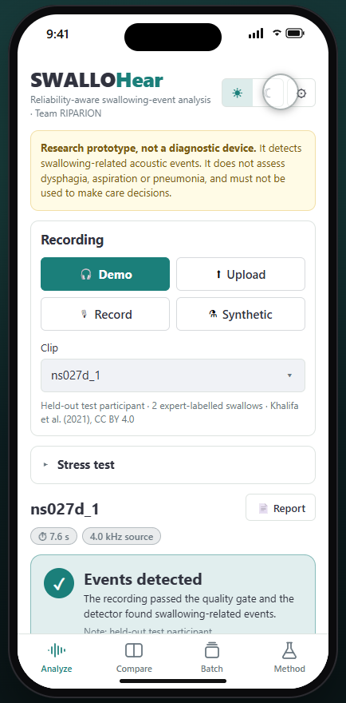 | **Welcome** The header has the light/dark switch and ⚙ for detector settings. The yellow banner is always there: SWALLOHear is a research prototype, not a diagnostic device. | 0:03 | [▶ clip](clips/01_welcome.mp4) |
| 2 | 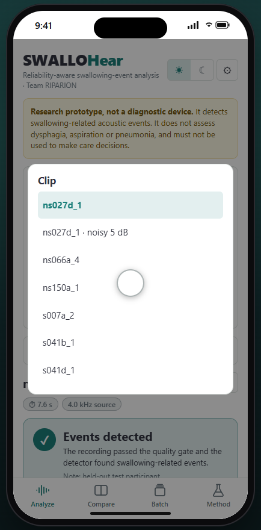 | **Pick a recording** Four sources: demo clips from held-out test participants, upload, the phone microphone, or synthetic test signals. Here: demo clip ns027d_1. | 0:12 | [▶ clip](clips/02_demo_clip.mp4) |
| 3 | 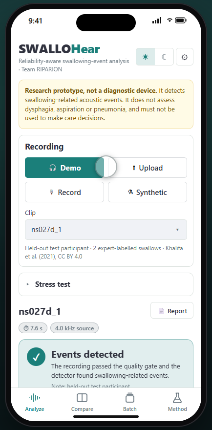 | **Verdict and summary** First the quality gate, then the verdict: events detected. The cards show confident and low-confidence events, event rate, estimated SNR against the gate, and processing time. | 0:21 | [▶ clip](clips/03_verdict.mp4) |
| 4 | 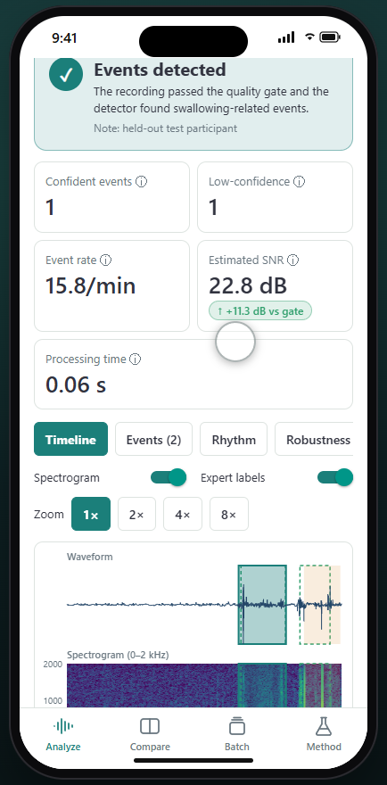 | **Timeline** Waveform, spectrogram and detector score on one time axis. Teal = Confident, amber = Low-confidence, dotted green = expert labels. Zoom up to 8× and swipe sideways. | 0:30 | [▶ clip](clips/04_timeline.mp4) |
| 5 | 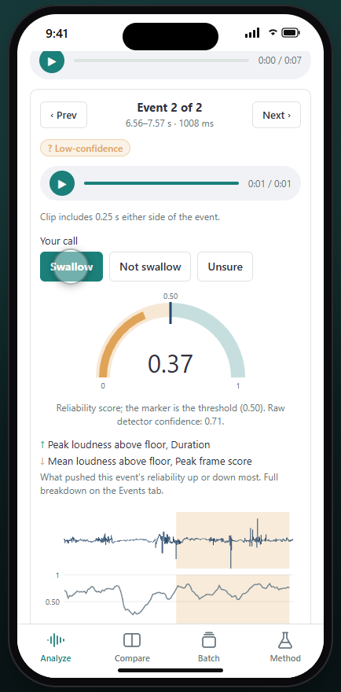 | **Event card** Tap a numbered marker to inspect an event: listen to just that sound, see its reliability against the threshold and what raised or lowered it, then record your own call. | 0:40 | [▶ clip](clips/05_event_card.mp4) |
| 6 | 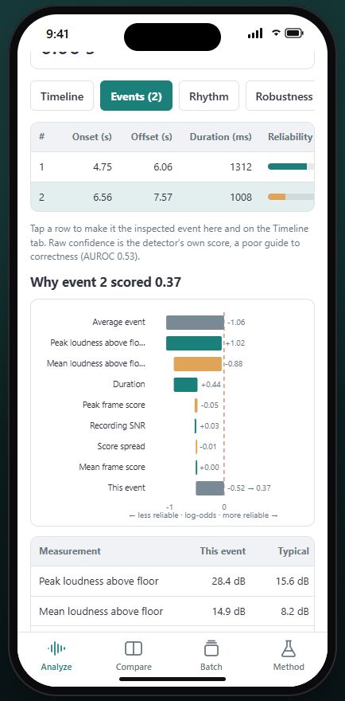 | **Events and “Why this score?”** A table of every event, then an exact breakdown of the reliability score: it starts from an average event and each measurement pushes it up (teal) or down (amber). | 0:53 | [▶ clip](clips/06_why.mp4) |
| 7 | 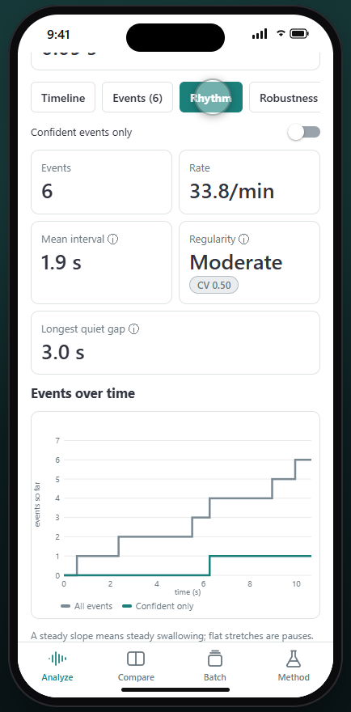 | **Rhythm** How swallowing is spread over time: rate, mean interval, regularity and the longest pause, with events-over-time and interval charts. Shown here on clip s007a_2, which has six events. | 1:09 | [▶ clip](clips/07_rhythm.mp4) |
| 8 | 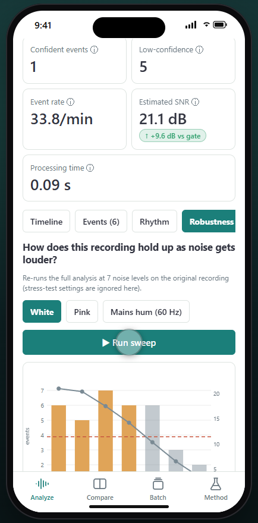 | **Robustness lab** Re-runs the analysis at seven noise levels. Watch the events thin out and the quality gate start withholding results once the estimated SNR falls below the red line. | 1:27 | [▶ clip](clips/08_robustness.mp4) |
| 9 | 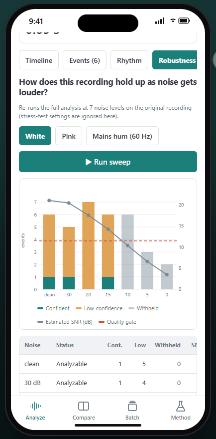 | **Signal quality** Every quality-gate check with its value and limit, how the SNR is estimated (noise floor vs peaks) and the average spectrum, where mains hum would show as spikes. | 1:37 | [▶ clip](clips/09_quality.mp4) |
| 10 |  | **Expert comparison** For labelled clips: matched events, false detections, misses, precision, recall and F1, and Expert vs System lanes (green = matched, red = unmatched). | 1:46 | [▶ clip](clips/10_expert.mp4) |
| 11 |  | **Session log** Every analysis run in this session, with exports of the log and of all your calls on events. | 1:55 | [▶ clip](clips/11_session.mp4) |
| 12 | 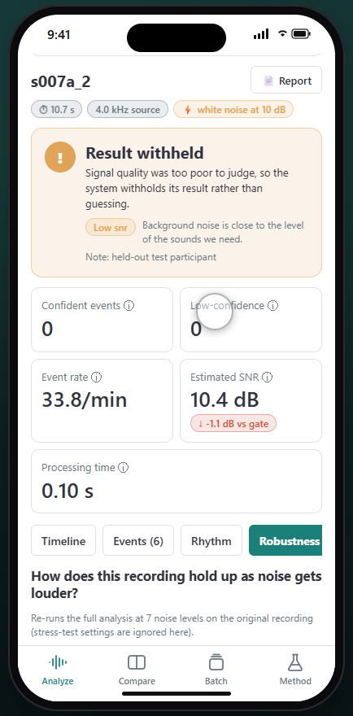 | **Stress test** Add white, pink or 60 Hz mains-hum noise, or simulate clipping. At 10 dB of white noise the estimated SNR drops below the gate and the result is withheld instead of guessed. | 2:04 | [▶ clip](clips/12_stress.mp4) |
| 13 | 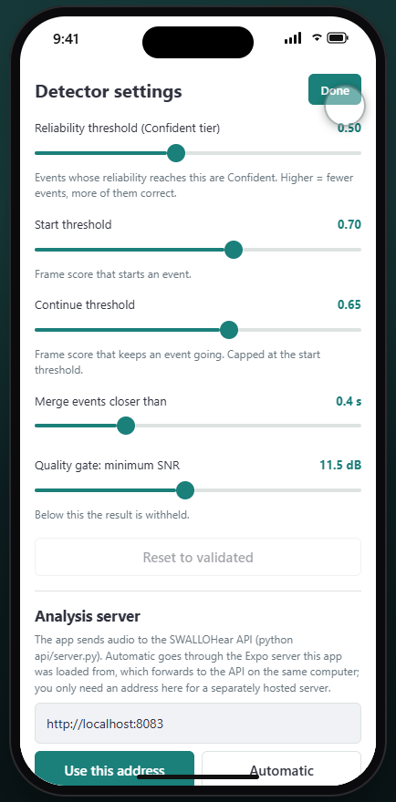 | **Detector settings** All five thresholds, live. Raising the reliability threshold makes fewer events Confident but more of them correct. “Reset to validated” restores the values the results were measured with. | 2:30 | [▶ clip](clips/13_settings.mp4) |
| 14 | 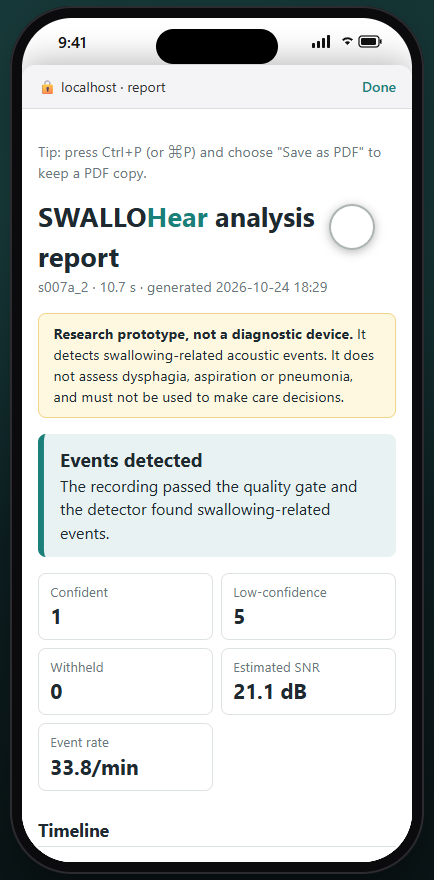 | **Printable report** 📄 Report opens a self-contained report in the browser: verdict, timeline, every event with its reasons and your calls, rhythm, quality and limits, ready to share or save as PDF. | 2:41 | [▶ clip](clips/14_report.mp4) |
| 15 | 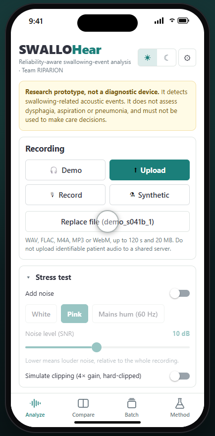 | **Upload a file** Choose any audio file on the phone (WAV, FLAC, M4A, MP3, WebM; up to 120 s). It is sent to the analysis server and analysed exactly like the demo clips. | 2:55 | [▶ clip](clips/15_upload.mp4) |
| 16 | 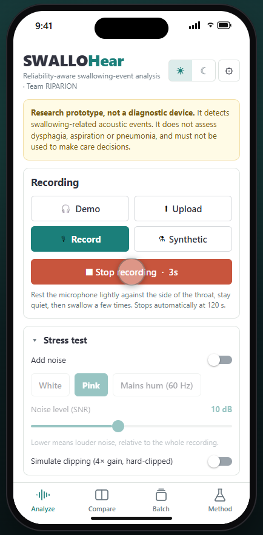 | **Record with the microphone** Rest the phone’s microphone lightly against the side of the throat and press record. When you stop, the recording is analysed straight away. (Here a test tone stands in for a throat recording.) | 3:04 | [▶ clip](clips/16_record.mp4) |
| 17 | 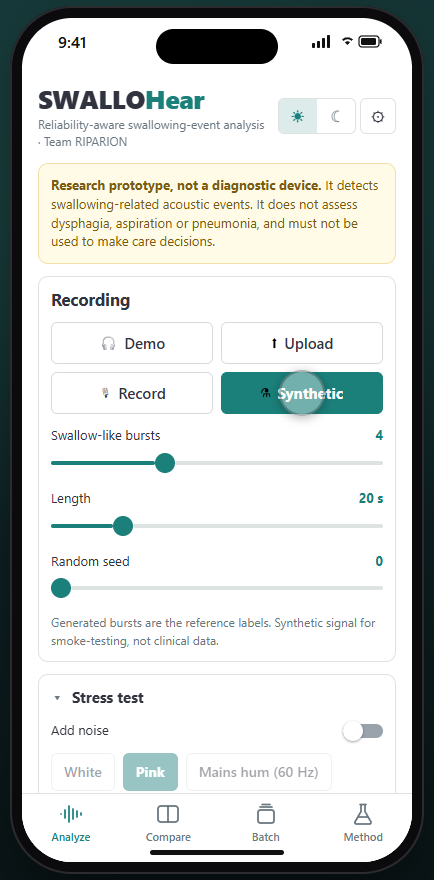 | **Synthetic test signals** Generated swallow-like bursts with known positions, for checking the pipeline end to end. Sliders set the number of bursts, the length and the random seed. | 3:20 | [▶ clip](clips/17_synthetic.mp4) |
| 18 | 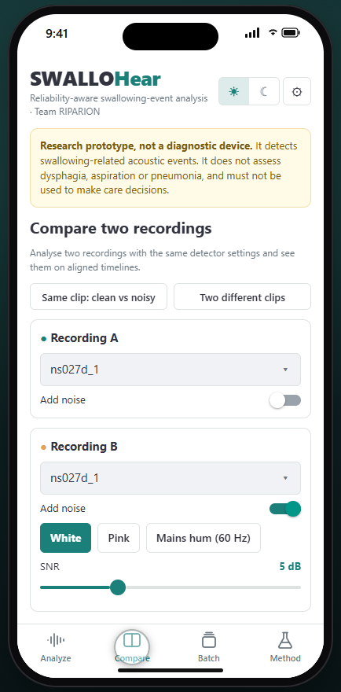 | **Compare** Two recordings side by side, here the same clip clean and with 5 dB of noise: a table with a B − A column, both detector scores overlaid, and timelines on a shared time axis. | 3:31 | [▶ clip](clips/18_compare.mp4) |
| 19 | 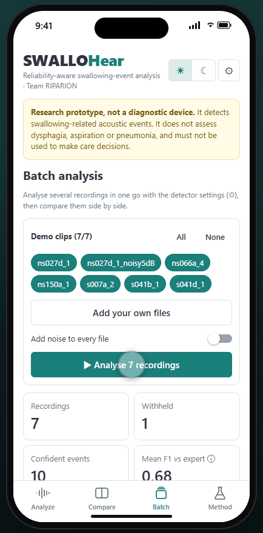 | **Batch** Analyse many recordings at once, with optional noise: totals, a table with mean reliability and F1, and an SNR-vs-events chart against the quality gate. | 3:47 | [▶ clip](clips/19_batch.mp4) |
| 20 | 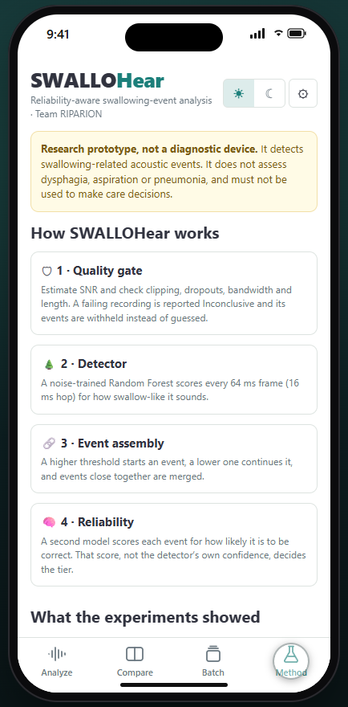 | **Method & results** How the pipeline works and what the experiments showed: noise robustness, and ordinary vs reliability-aware output at each noise level, then the headline numbers and limits. | 3:56 | [▶ clip](clips/20_method.mp4) |
| 21 | 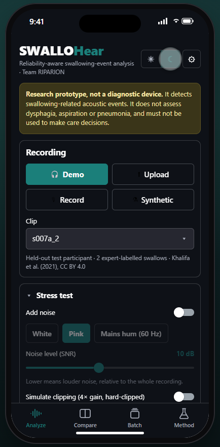 | **Dark mode** ☾ switches the whole app, charts included, and the choice stays as you move between tabs. | 4:12 | [▶ clip](clips/21_dark.mp4) |

## Re-recording

Start the analysis server (`python api/server.py`) and Expo (`cd mobile && npx expo start --port 8083`), then run
`python scripts/record_mobile_demo.py`. It rewrites this folder: `walkthrough.mp4`, `clips/`, `snapshots/`,
`highlights.gif`, `chapters.json` and this page. Needs `pip install playwright imageio-ffmpeg` and Microsoft Edge.
